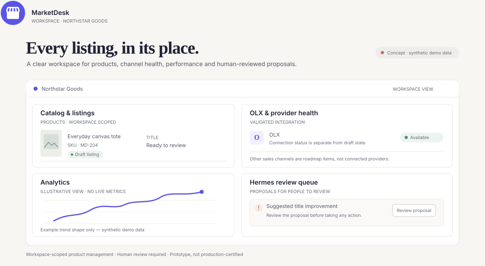

<div align="center">

# MarketDesk

**One workspace for seller operations: products, marketplace listings, analytics, and reviewable AI assistance.**

Project status: [prototype, not production-certified](.github/project-status.yml) · active implementation. Current releases use independent `backend-v*`, `frontend-v*`, and `assets-v*` component tags; combined `marketdesk-v*` tags remain historical rollback references.

</div>

<p align="center">
  <picture>
    <source media="(max-width: 767px)" srcset="docs/design/readme-showcase/marketdesk-readme-hero-mobile.svg" />
    
  </picture>
</p>

*Designed concept; all interface data is synthetic. See the [editable design source and provenance](docs/design/readme-showcase/README.md).*

[View the editable desktop source](docs/design/readme-showcase/marketdesk-readme-source.html)

MarketDesk is a workspace-scoped product and listing management platform. **OLX is the only validated real marketplace integration**; other channels are roadmap surfaces. In the default local setup OLX runs as a labelled [sandbox](#sandbox-mode) that never contacts OLX. Hermes recommendations require human review and guarded execution—not unattended automation. This project is a prototype, not production-certified.

## What you can do

- **Manage a product catalog** and prepare marketplace listings from one workspace.
- **Review listing and provider state** without confusing local drafts with marketplace truth.
- **Track operations and analytics** across current product/listing workflows.
- **Use Hermes-assisted recommendations** as proposals to inspect, approve, or dismiss. Without a Hermes Agent API server, simple built-in heuristics answer instead and are labelled as such.

## Get started

Requires Docker with Compose v2, plus Node.js 22+ and npm 10+ to run `npm run env:init`. Create `.env` before the first start: `npm run env:init` copies `.env.example` and generates the secrets the app needs.

```bash
git clone https://github.com/quokkify/marketdesk.git
cd marketdesk
npm run env:init
docker compose up -d --build
curl -fsS http://127.0.0.1:3000/health
curl -fsS http://127.0.0.1:3000/ready
curl -fsS http://127.0.0.1:3000/api/application-info
```

Open <http://localhost:3000> and create an account. The [tester guide](docs/TESTING_GUIDE.md) walks through the whole seller journey and lists what works and what does not yet.

`env:init` fills `JWT_SECRET`, `JWT_REFRESH_SECRET`, `HERMES_WEBHOOK_SECRET`, and `MARKETPLACE_CREDENTIALS_KEY` and keeps any value that is already set. The app refuses to start while `JWT_SECRET` or `MARKETPLACE_CREDENTIALS_KEY` is missing or a placeholder, and its log names the variable. Hermes is optional: keep the placeholder `HERMES_API_KEY` from `.env.example` and the app uses its offline heuristics, or set the key of a native Hermes Agent API Server to use Hermes instead. If you run a Hermes Agent API Server, restrict its host port with firewall/security-group rules to Docker traffic and trusted administrators. Compose runs upload initialization and database migrations before the app starts. For development without Docker, run `npm ci`, start local PostgreSQL and Redis, configure `.env`, then use `npm run dev`.

See [Development and operations](docs/development.md) for environment setup, checks, the network boundary, data safety, and troubleshooting. Never delete Compose volumes that contain data you need.

## Sandbox mode

With the default `.env`, OLX runs as a labelled sandbox (`OLX_ADAPTER_MODE=stub`) and MarketDesk never contacts OLX:

- Connecting OLX from the Marketplaces page creates a stand-in account that needs no OLX credentials. OLX state is labelled **Sandbox** wherever it is shown.
- Publishing still goes through the category review and confirmation, against built-in stand-ins for the OLX category tree and the publication quota. Sandbox adverts get placeholder `https://www.olx.pl/d/oferta/sandbox-…` links that do not exist on olx.pl.
- Importing existing OLX adverts is unavailable, and there are no real sales or traffic, so analytics stay mostly empty.
- `OLX_ADAPTER_MODE=real` switches to the real OLX Partner API and needs approved credentials; see [OLX real API readiness](docs/olx-real-api-readiness.md). A stored sandbox connection is refused in real mode and has to be reconnected. Do not publish, relist, or mutate real marketplace data without explicit authorization.

AI assistance follows `HERMES_PROVIDER_MODE` (default `auto`): Hermes while its Agent API server is configured and reachable, built-in offline heuristics otherwise. Offline suggestions say that Hermes was not consulted and always wait for human review. `hermes` never falls back, and `offline` never calls Hermes.

## Architecture

React 19 + TypeScript 6 frontend (MUI 9, Vite 8) · Node.js + Express 5 API · PostgreSQL 18 · Redis 8 · Docker Compose. Node.js 22+ is supported and the Docker image runs Node.js 24. Schema changes are ordered SQL migrations in `src/backend/persistence/migrations` that a one-shot Compose service applies before the app starts. Backend responsibilities follow domain, application, infrastructure, and presentation layers. The standard Compose deployment builds a **single combined application image** serving the API and SPA; separately published component images are an optional topology.

## Documentation

- [Tester guide](docs/TESTING_GUIDE.md): run MarketDesk locally and test the seller journey in sandbox mode
- [Product/spec source hierarchy](docs/spec/README.md) · [Product maturity](docs/spec/PRODUCT.md) · [Traceability](docs/spec/TRACEABILITY.md)
- [Canonical architecture](ARCHITECTURE.md) · [Original product requirements](docs/design/MarketDesk%20PRD.dc.html) · [Visual prototype](docs/design/MarketDesk.dc.html)
- [Existing product, analytics and dark-theme screenshots](https://github.com/quokkify/.github/tree/main/assets/projects/marketdesk) (visual references; not production-readiness claims)
- [Development and operations guide](docs/development.md)
- [Caddy + Cloudflare deployment](docs/deployment/caddy-cloudflare-vps.md) · [Release and migration safety](docs/deployment/release-version.md)
- Release histories: [Backend](src/backend/CHANGELOG-backend.md) · [Frontend](src/frontend/CHANGELOG-frontend.md) · [Assets](public/CHANGELOG-assets.md) · [Legacy migration audit](docs/deployment/changelog-history-migration.md)
- [Upload storage](docs/deployment/upload-storage.md) · [GHCR image contract](docs/deployment/container-images.md)
- [OLX publication quota guard](docs/olx-publication-quota.md) · [Hermes agent boundary](docs/marketdesk-agents.md)

## Maturity and contribution

MarketDesk is actively evolving; implemented surfaces and remaining acceptance gaps are tracked in [TRACEABILITY.md](docs/spec/TRACEABILITY.md). Product behavior and maturity rules are documented in [PRODUCT.md](docs/spec/PRODUCT.md). The prototype and screenshots are design references, not proof of production readiness.

Contributions should include focused tests and documentation updates where behavior changes. Open a pull request using the repository template. Do not publish, relist, or mutate real marketplace data without explicit authorization.
