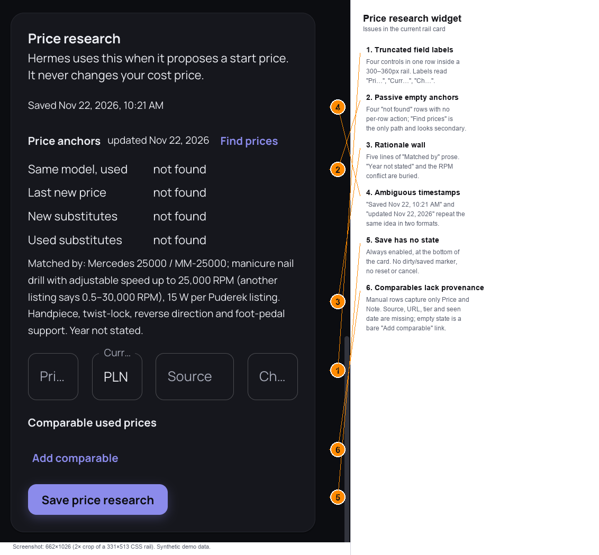
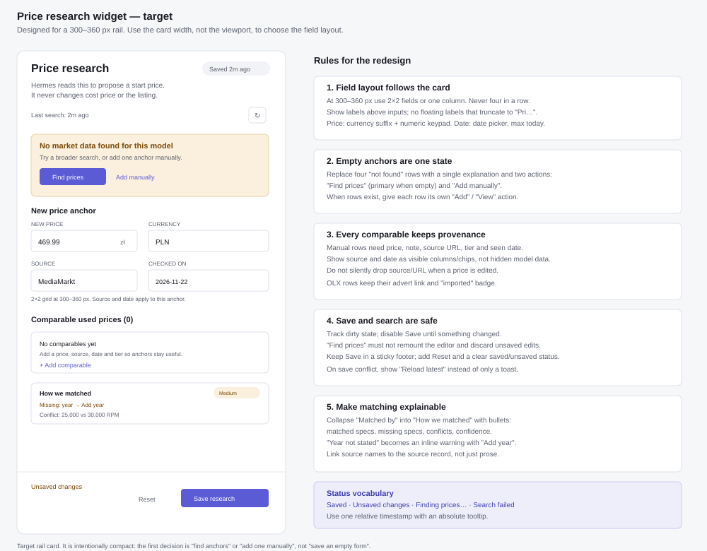

# Price research widget — UX audit addendum

**Related to:** [Product detail UX audit](./product-detail-ux-audit.md) · issue [#496](https://github.com/quokkify/marketdesk/issues/496)
**Route:** product detail rail, `PriceResearchSection` in `src/frontend/components/product-detail/PriceResearchSection.tsx`
**Date:** 2026-11-22 · **Scope:** the "Price research" card shown in the product detail rail.

> The widget is **not present in this docs branch**. It was inspected on `feat/price-research-graph` at `4f41134aef`, together with the code in `PriceResearchSection.tsx` and `priceResearchModel.ts`. The screenshot is a 2× crop of a 331 × 513 CSS rail card in the sandbox demo. All data is synthetic.



Raw screenshot: [`assets/price-research-widget.png`](./assets/price-research-widget.png).

The target layout is [`assets/price-research-widget-target.svg`](./assets/price-research-widget-target.svg):



---

## 1. What the widget does today

- It is a `Card` in the product detail rail, placed after the selling-price and statistics cards and before Hermes.
- The card title is **Price research**; the subtitle says Hermes uses it for a start-price proposal and never changes cost price.
- It shows a **Saved** timestamp, a **Price anchors** section with four fixed tiers, a **Matched by** prose block, a four-field retail-anchor form, a **Comparable used prices** editor, and a **Save price research** button.
- "Find prices" calls a refresh mutation. Prices in PLN are the only searchable case; otherwise the button is disabled and a caption explains `OLX search needs a PLN listing`.
- The model supports per-comparable `source`, `url`, `tier`, `seenAt` and `classAttributes`; the form only edits `price` and `note`.
- The rail is 300–360 px wide at `lg` (the same `productDetailGridSx` grid used by the main audit).

The card is functionally rich, but it behaves like a database form that happened to land in a narrow rail. The main problems are not missing data fields; they are layout, state, and decision support.

---

## 2. Findings

### P0-1 — The four retail fields truncate into meaningless labels

**Evidence.**
- The editor lays out four `TextField`s in one `Stack` with `direction={{ xs: 'column', sm: 'row' }}` and only gives `Source` `fullWidth`.
- `sm` is a **viewport** breakpoint (600 px), not a container breakpoint. At a 1568 px viewport, the rail is still 300–360 px, so all four fields are forced into one row inside the rail.
- In the screenshot the visible labels are `Pri…`, `Curr…`, `Source`, `Ch…`; the intended labels are `Price of a new one`, `Currency`, `Source`, `Checked on`.
- The source is `Stack` + `TextField` in `PriceResearchSection.tsx`; the card content width is roughly 300 px after padding.

**Why it matters.** A user cannot tell what `Pri…` or `Ch…` means; the two most important fields (what price, when checked) are unreadable. This is a responsive bug, not a cosmetic edge case: the widget is designed for the rail but laid out for a full-width form.

**Recommendation.**
- Use **container queries** (`@container`) or a measured layout, never the viewport `sm` breakpoint, for the card's internal grid.
- At a 300–360 px card, use a **2×2 grid**:
  - row 1: New price (with currency suffix) + Currency select;
  - row 2: Source + Checked on (date picker).
- Put labels **above** the inputs. Do not rely on MUI floating labels that shrink/truncate.
- Make `Source` full-width on its row; make `Checked on` use a native/date picker, not a text placeholder.
- Test the card at 300, 331 and 360 px, and at 200 % browser zoom.

**Acceptance.** Every field label is fully readable at 300 px card width; no label ends in an ellipsis; the form has no horizontal overflow.

**Files.** `PriceResearchSection.tsx` (`PriceResearchEditor`), `priceResearchModel.ts` (field labels/validation).

---

### P0-2 — "Find prices" can silently discard unsaved research

**Evidence.**
- `PriceResearchEditor` is keyed by `` `${productId}:${research?.updatedAt ?? 'none'}` ``.
- `refreshPriceResearch` invalidates the `PriceResearch` tag; the refetch returns a new `updatedAt`; the key changes and the editor **remounts** with the server's form values.
- The form has no dirty state and no confirmation before `Find prices`; the handler is just `refresh(productId)`.
- If the owner has typed a comparable or a source and then presses `Find prices`, an update to `updatedAt` replaces the whole draft.

**Why it matters.** This is silent data loss in a form whose purpose is manual research. It also trains users not to trust the card: the obvious next action after seeing empty anchors destroys their work.

**Recommendation.**
- Do not remount the editor on every refresh. Keep the form draft in a stable component/store and merge new anchors into it, or key only by `productId` and explicitly reset on product change.
- Add a **dirty** comparison against the last saved/loaded snapshot.
- If a refresh must replace user edits, show a confirmation: "Finding prices will replace your unsaved changes. Continue?" with "Save first" as the default action.
- Preserve the draft on save errors and on network retry.
- Warn on navigation away when dirty (router blocker or an in-card "Unsaved changes" state).

**Acceptance.** Typing a comparable, pressing `Find prices`, and receiving new anchors never removes the typed row without explicit confirmation; a dirty form survives a failed refresh.

**Files.** `PriceResearchSection.tsx`, `priceResearchModel.ts`, `productsApi.ts` (invalidation/merge), `ListingDetailsPage.tsx` if a navigation guard is added.

---

### P0-3 — Four "not found" rows are a dead end

**Evidence.**
- `anchorTierLines` always returns four rows; empty tiers render the literal string `not found`.
- The only search action is a small `Find prices` button in the section header. There is no per-row action, no "add manually" path, and no explanation of what would make a match.
- `Save price research` remains the visually dominant button even when every anchor is empty.
- On failure, the UI test expects only a toast: `Market search is not configured`.

**Why it matters.** The empty state reads as "the system failed four times" and offers no next step. A seller cannot tell whether to change the product title, add a model number, search a different marketplace, or enter a comparable manually.

**Recommendation.**
- Collapse the four empty rows into one **empty state**:
  - title: "No market data found for this model";
  - body: "Try a broader search, or add one anchor manually.";
  - primary: **Find prices**;
  - secondary: **Add manually**.
- When at least one tier has data, show the four-row table; empty rows get `—` and an inline **Add** action.
- Make the primary action state-dependent:
  - no research → `Find prices`;
  - dirty research → `Save research`;
  - searching → `Finding prices…` with spinner and disabled state.
- After a search, show **what ran**: provider/source, timestamp, number of matches, and exclusions. If search is not configured, show an inline alert with "Configure market search" or "Add manually", not only a toast.
- Use "No match" rather than lowercase `not found` in visible copy, and use a muted status, not body text that looks like a price.

**Acceptance.** When all anchors are empty, the card presents one explanation and two actions; there are no four identical passive rows; a failed search is visible inline and has a retry path.

**Files.** `PriceResearchSection.tsx` (`PriceAnchors`), `priceResearchModel.ts` (`anchorTierLines`/copy), `test-automation/.../ProductDetailPageSteps`.

---

### P1-4 — Manual comparables lose provenance, tier and date

**Evidence.**
- `PriceComparable` supports `source: 'manual' | 'web' | 'auto'`, `url`, `tier`, `seenAt`, `classAttributes`, `classChecked`.
- The editor renders only **Price** and **Note** + a delete button. `Add comparable` creates `{ price: '', note: '' }`; no source URL, tier or seen date can be entered.
- `editComparablePrice` deliberately drops `source` and `url` from a web row when the price is edited; a manual row keeps no provenance at all.
- Untiered rows are treated as `same_model_used` (`anchorTierLines`), so manually added rows can never populate "Last new price", "New substitutes" or "Used substitutes".

**Why it matters.** The anchors look authoritative but the manual path cannot explain where a number came from. A seller cannot record "OLX, 12 Nov, 250 zł, used substitute" even though the data model supports it. Hermes receives a weaker signal than the UI implies.

**Recommendation.**
- Make each comparable a small row/card with: **Price**, **Note/title**, **Source URL**, **Source type** (OLX / web / manual), **Tier**, **Seen date**, optional condition. Delete stays.
- Show source and date as visible chips/columns in read view; link OLX URLs.
- Keep `source`/`url` when the price is edited, or show "This will become a manual row" before dropping them.
- Provide an "Import from OLX" path for the `web` rows already supported by the backend.
- Preserve the existing max of 30 and per-row validation; add a count.

**Acceptance.** A user can add a comparable with price, source, tier and date; the saved row shows those values after reload; editing a price does not silently erase a source URL.

**Files.** `PriceResearchSection.tsx` (`PriceResearchEditor`), `priceResearchModel.ts` (`PriceResearchForm`/`toPriceResearchBody`), `PriceComparable` type if new fields are surfaced.

---

### P1-5 — Save has no state, no exit and no sticky action

**Evidence.**
- Save is `disabled={saving}` only; there is no dirty comparison. The button is always enabled when idle.
- The form has no Reset/Cancel.
- The card can contain up to 30 comparables; Save sits at the bottom of the card after the entire list. The screenshot shows a scrollbar already at four fields and an empty comparables section.
- After save, `research.updatedAt` changes and the editor remounts, so there is no local "saved" feedback beyond the global toast.
- On a stale save, the server rejects with "Price research changed since you opened it. Reload and try again."; the UI only shows a toast, with no reload action in the card.

**Recommendation.**
- Track dirty/saved state; **disable Save until something changes** and show `Unsaved changes` / `Saved 2m ago`.
- Put Save in a **sticky footer** of the card so it stays reachable with 30 comparables.
- Add **Reset** (restore last saved state) and, if the card is presented in a modal, Cancel/Close.
- On a stale-save error, render an inline banner with **Reload latest** and keep the draft visible until the user chooses.
- Show a local "Saved" confirmation with timestamp; keep the toast for cross-page feedback only.

**Acceptance.** Save is disabled on a clean form and enabled after any change; the action is reachable without scrolling; a conflict offers reload without losing the draft.

**Files.** `PriceResearchSection.tsx`, `priceResearchModel.ts`, `ListingDetailsPage.tsx`.

---

### P1-6 — Two timestamps, two formats, two meanings

**Evidence.**
- Header: `Saved ${formatDateTime(research.updatedAt)}` → "Saved Nov 22, 2026, 10:21 AM".
- Anchors: `` updated ${formatDate(research.lastAttemptAt)} `` → "updated Nov 22, 2026".
- `updatedAt` is the last manual save; `lastAttemptAt` is the last price search. The labels do not make that distinction.

**Why it matters.** The user cannot tell whether the anchors or their manual edits are fresh, or whether "Find prices" ran at all. On a research card, recency is part of trust.

**Recommendation.**
- Use one status line: **Saved 2m ago · Last search 2m ago** (absolute datetime in tooltip).
- If no search ran: **Not searched yet** rather than an empty/undefined timestamp.
- Use relative time consistently; do not mix `Nov 22, 2026, 10:21 AM` and `Nov 22, 2026`.
- If these are different events, label them as "Saved manually" and "Last price search".

**Acceptance.** A user can distinguish manual save from search and see how old each is; no duplicate timestamp with different formats.

**Files.** `PriceResearchSection.tsx`, `formatters.ts`.

---

### P1-7 — The match rationale is a wall; missing data is buried

**Evidence.**
- `research.specs` is rendered as one `caption` paragraph prefixed `Matched by:`.
- The screenshot contains five lines of prose, including "another listing says 0.5–30,000 RPM", "15 W per Puderek listing", and "Year not stated."
- There is no confidence indicator or link on the source name (`Puderek listing`).

**Why it matters.** This is the trust layer for an AI-assisted price. The important facts — the model match, the conflicting RPM range, the missing year — are hidden in a paragraph that reads like a log line. A missing year also has a direct action: add it to the product to improve future matching.

**Recommendation.**
- Replace the paragraph with a collapsible **"How we matched"** disclosure:
  - matched attributes as chips (model, RPM, power, handpiece, etc.);
  - **Missing:** Year — with "Add year" link to edit the product;
  - **Conflict:** 25,000 vs 30,000 RPM — warning, not buried prose;
  - source names as links, with advert count and date.
- Show a confidence badge (high/medium/low) and the number of matches.
- Keep the full raw rationale available under the disclosure for auditability.

**Acceptance.** Missing/conflicting match attributes are visible without expanding; "Add year" is one click; each source is identifiable and, where available, linked.

**Files.** `PriceResearchSection.tsx` (`PriceAnchors`), `priceResearchPrompts.ts`/`priceResearchModel.ts` if the rationale is structured further.

---

### P2-8 — Currency and date use free-text controls

**Evidence.**
- Currency is a `TextField` validated against `^[A-Z]{3}$` after save.
- Checked-on is a `TextField` with placeholder `YYYY-MM-DD`; `isIsoDate` rejects it only on save.
- The price field has `inputMode="decimal"` but no currency suffix or formatting.

**Why it matters.** A user typing `zł`, `PL` or `22.11.2026` only learns the rule after pressing Save. The card asks for structured data but presents text boxes.

**Recommendation.**
- Price: numeric field with a currency suffix/adornment, comma or dot accepted, two decimals.
- Currency: a select with common currencies plus a custom three-letter option; default to the workspace currency.
- Checked on: a date picker with max=today and a locale-formatted display; send ISO to the API.
- Validate on blur and keep helper text; never make the user submit to discover the format.

**Acceptance.** A user cannot enter an invalid currency or date through the normal UI; the price field shows the currency next to the value.

**Files.** `PriceResearchSection.tsx`, `priceResearchModel.ts`.

---

### P2-9 — Narrow anchor rows are not robust to long values

**Evidence.**
- `PriceAnchors` renders each tier as `Stack direction="row"` with a label `minWidth: 140` and no `flexWrap` or `minWidth: 0`.
- Values can be long: `from 1 000 zł (10)`, notes, multiple source links.
- At 300–360 px, the label plus value plus links can overflow; the current screenshot only shows the short `not found` values.

**Recommendation.**
- Use a grid with `gridTemplateColumns: 'minmax(0, 1fr) auto'` or a definition list; allow the value to wrap.
- Move external links to a compact icon button with an aria-label; do not append multiple `↗` links inline at the end of the row.
- Test with a 1,000-character note, 10 matches, and a long source name.

**Acceptance.** No horizontal overflow at 300 px with long values; links are reachable and labelled.

**Files.** `PriceResearchSection.tsx`, `priceResearchModel.ts` tests.

---

### P2-10 — The card is too tall and too deep in the rail

**Evidence.**
- The card is placed after Selling price and Statistics in the existing rail. The main audit already measures the rail at 1941 px; adding this editor makes it longer.
- With four fields, an empty comparables section and a Save button, the screenshot is already 1026 px at 2× (513 CSS px); with rows it grows toward the 30-comparable limit.
- There is no collapsed summary or anchor in the page; the card is only reachable by scrolling.

**Recommendation.**
- Default to a compact **read summary**:
  `New 469.99 zł · Used 200–285 zł · 3 comparables · Saved 2m ago` with **Edit research**.
- Expand the editor on demand, or move it into a "Pricing" section/tab near the selling-price summary.
- If it stays in the rail, place it near the selling price and make the summary sticky/collapsible; do not put a full form below statistics and above Hermes.
- Add an in-page anchor from the price summary ("Price research · 3 comparables") to this card.

**Acceptance.** The collapsed card is ≤ 160 px; the page's primary summary can link to it; expanding does not push Hermes below the fold without a way back.

**Files.** `PriceResearchSection.tsx`, `ListingDetailsPage.tsx`, `ProductDetailSections.tsx` (price summary link).

---

### P2-11 — Accessibility gaps

**Evidence.**
- Truncated visible labels (`Pri…`, `Curr…`, `Ch…`) also create weak visual labels; MUI may keep full accessible names, but sighted users lose them.
- The retail fields are not wrapped in a `fieldset`/`legend` or labelled group.
- The anchor rows are plain `Stack`/`Typography`, not a table or definition list; the four tiers and values have no semantic relationship.
- Search progress is only a spinner inside the button; there is no `aria-live` for "finding prices", success or error.
- Add/remove comparable changes the list dynamically without focus management or an announcement.
- The Save button is always enabled and has no `aria-disabled` reason when clean.

**Recommendation.**
- Wrap the retail anchor in `fieldset`/`legend` "New price anchor"; wrap comparables in a labelled group.
- Use a table or `<dl>` for anchor tiers; give each row a header and value.
- Add an `aria-live="polite"` status region for search/save results and dirty state.
- Move focus to the new row after "Add comparable"; return focus to the add button after delete.
- Ensure all inputs have visible, full labels; keep 44 px targets.
- Add a "Skip to comparables" or at least logical tab order; test with keyboard only.

**Acceptance.** Screen reader announces the section structure, search state and save result; keyboard focus follows add/remove; no label relies on a tooltip.

**Files.** `PriceResearchSection.tsx`, `Card.tsx` (if heading levels are changed), tests.

---

### P3-12 — Copy and terminology

**Evidence.** `not found`, `Matched by:`, `updated Nov 22, 2026`, `Saved Nov 22, 2026, 10:21 AM`, `start price`, `It never changes your cost price`.

**Recommendation.**
- "No match" / "No market data" instead of `not found`.
- "Last search" instead of `updated`.
- "How we matched" instead of `Matched by`.
- "Proposed start price" and "It never changes your cost price or listing price without your approval" (if that is the actual behavior).
- Use one timestamp format per context (relative in the card, absolute in tooltips).
- Use sentence case for status labels; keep `PLN` as a code.

**Acceptance.** No raw status string `not found` in visible copy; one timestamp convention; no duplicated meaning.

---

## 3. Target design

The widget is a **research aid**, not a form to complete. The first decision is "do we have anchors, or do we need to add one manually?" The form comes after that.

### 3.1 Collapsed read state

```text
Price research                              Saved 2m ago
New 469.99 zł · Used 200–285 zł · 3 comparables
[Edit research]  [Find prices]              [Open OLX sources]
```

- Show the three numbers that matter; do not show four empty tiers and a 500 px form by default.
- If there is no research: `No research yet · Find prices / Add manually`.
- Link to the full editor; keep the editor state local while open.

### 3.2 Expanded editor

1. **Status line** — `Saved 2m ago · Last search 5m ago` with absolute tooltips; `Not searched yet` when applicable.
2. **Price anchors**
   - If all empty: one empty-state block with **Find prices** (primary) and **Add manually** (secondary).
   - If some data: a four-row table (`Same model, used`, `Last new price`, `New substitutes`, `Used substitutes`) with value/range, count, source chip, and an inline **Add** for empty rows.
   - Show provider/result count and an inline search error with retry.
3. **New price anchor** — 2×2 grid: New price + currency suffix, Currency select, Source, Checked on date.
4. **Comparable used prices (N)** — rows with Price, Note/title, Source/URL, Tier, Seen date, delete; `+ Add comparable`; empty state explains what to add.
5. **How we matched** — collapsible; matched chips, missing/conflicting specs, confidence, source links, "Add year".
6. **Sticky footer** — `Unsaved changes` or `Saved 2m ago`; Reset; Save research (disabled when clean).

### 3.3 State matrix

| State | Header status | Primary action | Secondary | Anchors area |
| --- | --- | --- | --- | --- |
| No research | Not searched yet | **Find prices** | Add manually | Empty state |
| Searching | Finding prices… | disabled + spinner | Add manually | Keep last results |
| Results | Last search 2m ago | Save research (if dirty) | Find again / Add manually | Four rows + sources |
| Dirty | Unsaved changes | **Save research** | Reset | Rows + edits |
| Saved | Saved just now | Find prices / Find again | Edit | Read-only summary |
| Search error | Search failed | **Retry** | Add manually | Inline error with reason |
| Not PLN | Search needs a PLN listing | disabled + reason | Add manually | Inline explanation |

### 3.4 Copy

- "Price research" (title) — keep.
- "Hermes uses this to propose a start price. It never changes your cost price; you approve any price change." — clearer than the current two-line subtitle.
- "No market data found for this model." / "Try a broader search, or add one anchor manually."
- "No comparables yet." / "Add a price, source, date and tier so Hermes has usable evidence."
- "Saved just now" / "Last search 2 minutes ago".
- "How we matched" / "Missing: year" / "Conflict: 25,000 vs 30,000 RPM".

---

## 4. Implementation plan

> These changes belong on `feat/price-research-graph` (or a branch based on it). The docs branch only carries this brief.

### Task 1 — Responsive field grid and labels (P0)

**Files:** `PriceResearchSection.tsx`, `priceResearchModel.ts`, theme/container helper.

1. Replace the `Stack direction` with a CSS grid keyed to the **card** width:
   - `grid-template-columns: repeat(2, minmax(0, 1fr))` at 300–360 px;
   - one column below 300 px or when the source is long.
2. Put labels above inputs (or use `InputLabelProps={{ shrink: true }}` with full labels and `white-space: nowrap` only when there is room). Never ellipsize a field label.
3. Add a currency suffix to price and a date input for checked-on.
4. Remove `sm` viewport assumptions from the card.

**Acceptance:** full labels at 300/331/360; no horizontal overflow; 200 % zoom passes.

### Task 2 — Preserve drafts across search (P0)

**Files:** `PriceResearchSection.tsx`, `priceResearchModel.ts`, `productsApi.ts`.

1. Remove the `updatedAt` from the editor `key`; key by `productId`.
2. Keep a `dirty` snapshot; compare current form to last saved/loaded.
3. On `Find prices`:
   - if dirty, open a confirmation with "Save first" / "Discard and search" / "Cancel";
   - merge new anchor rows without clearing unrelated fields;
   - if the server version changed, preserve the draft and show an inline reload action.
4. Add a router-level unsaved guard or at least a beforeunload warning while dirty.

**Acceptance:** typed rows survive search and failed saves; no silent reset.

### Task 3 — Empty-state and search feedback (P0)

**Files:** `PriceResearchSection.tsx`, `PriceAnchors`, `priceResearchModel.ts`, UI tests.

1. Detect `all anchors empty` and render one empty state; keep the four-row table only when at least one tier has data.
2. Dynamic primary action by state (see matrix).
3. Inline search status/error with retry and a "Configure market search" action where available.
4. Show provider, result count, last run and links; use "No match" instead of `not found`.

**Acceptance:** all-empty state has one explanation and two actions; failed search is inline and retryable.

### Task 4 — Provenance and comparable editor (P1)

**Files:** `PriceResearchSection.tsx`, `priceResearchModel.ts`, maybe `PriceComparable` type.

1. Add per-row fields for source URL, source type, tier and seen date.
2. Keep source/URL when the price changes, or ask before converting a web row to manual.
3. Show source/date chips in the read view; link OLX URLs.
4. Add an empty state and a row count; retain the 30-row limit and validation.

**Acceptance:** a manually added comparable round-trips all displayed values; no silent provenance loss.

### Task 5 — Save state and timestamps (P1)

**Files:** `PriceResearchSection.tsx`, `priceResearchModel.ts`, `formatters.ts`.

1. Compute dirty; disable Save when clean; show `Unsaved changes` / `Saved just now`.
2. Sticky footer with Save and Reset.
3. Inline stale-save banner with **Reload latest**, preserving the draft.
4. One status line for manual save and last search; relative time with absolute tooltip.

**Acceptance:** clean Save is disabled, dirty Save is enabled and stays visible, conflict is actionable.

### Task 6 — Rationale and matching (P1)

**Files:** `PriceResearchSection.tsx`, `priceResearchModel.ts`, `priceResearchPrompts.ts` (only if the API is extended).

1. Render a collapsible "How we matched"; structure matched/missing/conflicting specs.
2. Add a confidence badge and source links.
3. Add "Add year" (or generic "Add missing attribute") that opens product edit focused on the field.
4. Keep the raw rationale under the disclosure for auditability.

**Acceptance:** missing/conflicting data is visible without expanding; each source is identifiable.

### Task 7 — Compact read mode and placement (P2)

**Files:** `PriceResearchSection.tsx`, `ListingDetailsPage.tsx`, `ProductDetailSections.tsx`.

1. Default to a compact summary; expand the editor on demand.
2. Add an in-page anchor from the selling-price summary.
3. Keep the expanded editor near pricing, not below statistics and above Hermes.
4. Cap the collapsed card at 160 px; test the rail at 300–360 px.

**Acceptance:** collapsed card ≤ 160 px; Hermes is not pushed below the fold by a closed editor.

### Task 8 — Accessibility and tests (P1)

**Files:** `PriceResearchSection.tsx`, `priceResearchModel.test.ts`, `PriceResearchUiTest.java`, Playwright.

- Fieldset/legend for the retail anchor; table/dl for anchors; aria-live for search/save.
- Keyboard add/remove focus management; 44 px targets.
- Unit tests: all-empty state, dirty state, draft-preserving refresh, per-row round-trip, stale save.
- UI tests: label visibility at 300 px, empty state actions, search failure inline, save disabled when clean.
- Visual baselines for empty/expanded/dirty/error in light and dark.

---

## 5. Acceptance checklist

- [ ] At a 300–360 px card width, `Price of a new one`, `Currency`, `Source` and `Checked on` are fully readable; no `Pri…`/`Curr…`/`Ch…`.
- [ ] There is no horizontal overflow with long values, 10+ matches or 30 comparables.
- [ ] "Find prices" never discards unsaved edits without confirmation.
- [ ] All-empty anchors render one explanation with "Find prices" and "Add manually", not four passive "not found" rows.
- [ ] Search shows progress, result count/provider and an inline retryable error.
- [ ] A manual comparable can store price, source URL, tier and seen date; values round-trip and display.
- [ ] Save is disabled when clean, sticky when the form is long, and offers Reset; stale save offers Reload latest.
- [ ] Manual save and last search are distinguishable; one relative timestamp convention.
- [ ] Missing year and conflicting RPM are visible as warnings with actions, not buried in prose.
- [ ] Collapsed card ≤ 160 px; expanded editor is reachable from the price summary.
- [ ] Screen reader announces the sections, search state and save result; keyboard add/remove works.
- [ ] Light/dark visual baselines for empty, expanded, dirty, searching and error states.

## 6. Non-goals

- Do not change the price-research API shape unless per-row provenance cannot be expressed; the current `PriceComparable` already has the fields.
- Do not change the product cost price or listing price from this widget; it remains review-only research.
- Do not add a new marketplace integration; OLX is the only searchable source in this setup.
- Do not redesign the whole product detail rail again in this task; the compact mode should fit the existing layout.

## Appendix — Source pointers

| Concern | Location |
| --- | --- |
| Card and editor | `src/frontend/components/product-detail/PriceResearchSection.tsx` |
| Form/model/validation/copy | `src/frontend/components/product-detail/priceResearchModel.ts` |
| API query/mutations | `src/frontend/state/api/productsApi.ts` |
| Placement in the rail | `src/frontend/pages/ListingDetailsPage.tsx` |
| Shared types | `src/shared/types/index.ts` (`PriceResearch`, `PriceComparable`, `AnchorTier`) |
| Existing UI tests | `test-automation/src/test/java/dev/quokkify/marketdesk/test/ui/PriceResearchUiTest.java` |
| Model tests | `src/frontend/components/product-detail/priceResearchModel.test.ts` |
| Source branch | `feat/price-research-graph` at `4f41134aef` |
