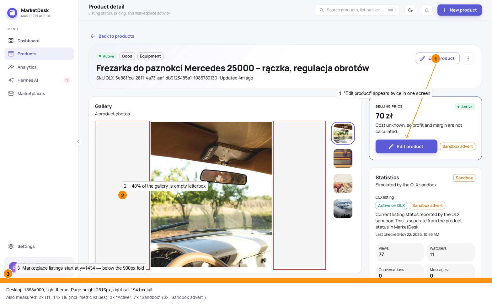
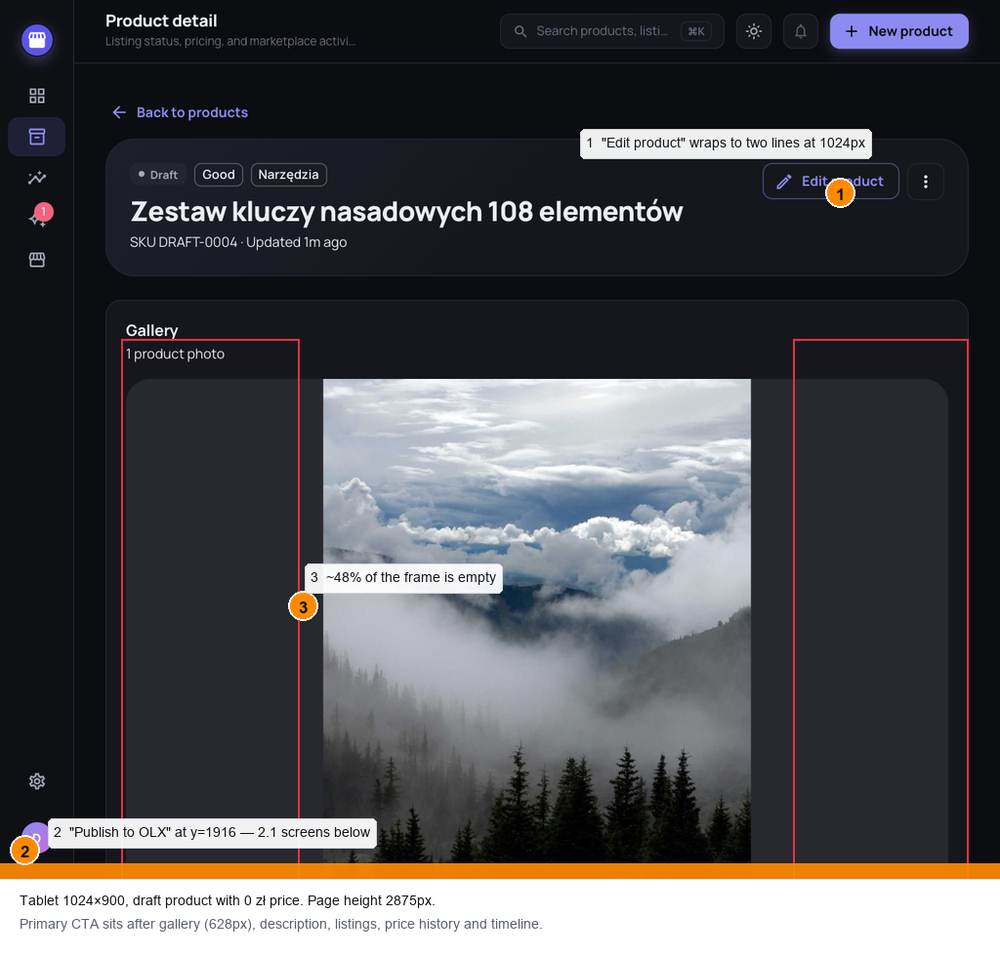
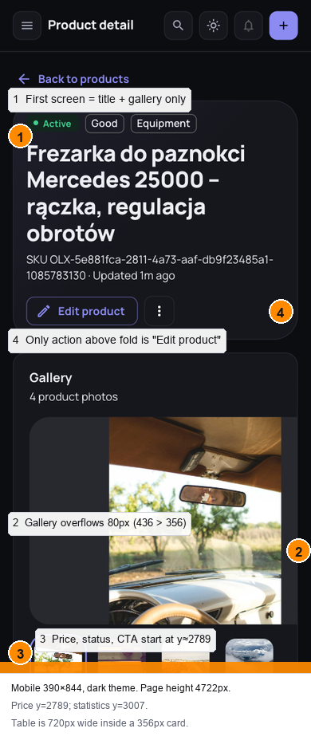
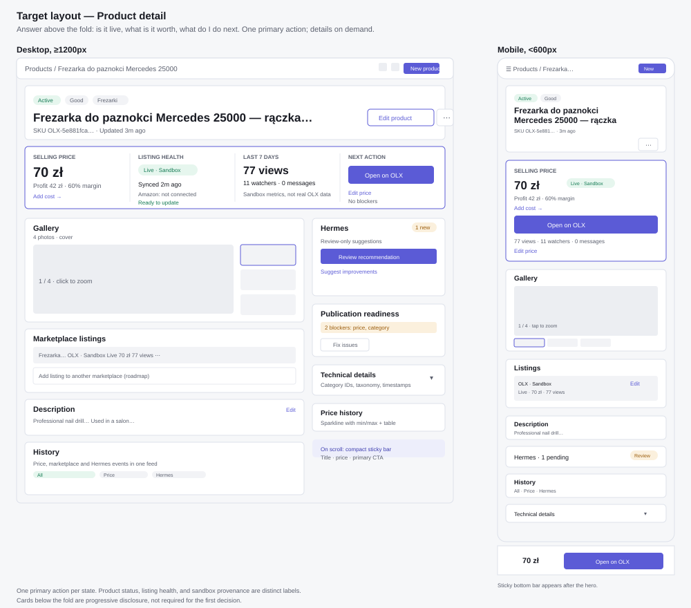

# Product detail — UX audit and implementation brief

**Route:** `/products/:productId` · **Main files:** `src/frontend/pages/ListingDetailsPage.tsx`, `src/frontend/components/product-detail/ProductDetailSections.tsx`
**Date:** 2026-11-22 · **Status:** research complete, ready for implementation · **Issue:** [#496](https://github.com/quokkify/marketdesk/issues/496)
**Scope:** the product detail screen shown after opening a product, at desktop, tablet and mobile widths, in light and dark themes.

---

## 1. Executive summary

The page contains the right information, but it is organised by **cards** rather than by the seller's decisions. On a 1568×900 desktop the first screen shows a 564 px gallery, a duplicated price card and a duplicated status; the marketplace listing table starts at **y = 1434**, below the fold. On a 390×844 phone the selling price, listing health and the listing-level primary action start at **y ≈ 2789**, more than three screens down, while the first screen is consumed by a four-line title and a gallery.

The five changes with the highest expected impact:

1. **Put one summary above the gallery** — price, listing health, 7-day performance, and the one next action. Keep it visible at mobile widths and on scroll.
2. **Remove duplicated actions, statuses and provenance labels.** The current page renders "Edit product" twice, "Active" three times, and "Sandbox" seven times.
3. **Do not make the whole 1941 px rail sticky.** It cannot stick in a 900 px viewport; make only a compact summary/action bar sticky.
4. **Fix responsive layout bugs now:** the gallery overflows its card by 80 px at 390 px, the listings table is 720 px wide inside a 356 px container, and the primary "Publish to OLX" action is 1916 px down at 1024 px.
5. **Fix the semantic and contrast defects:** two `h1` elements, 14 `h6` elements including metric values, and status chips with 3.0–3.6:1 contrast in the light theme.

A target layout is included in [Target design](#6-target-design) and as an editable wireframe: [`assets/product-detail-target.svg`](./assets/product-detail-target.svg).

---

## 2. Method and evidence

### Environment

- Local Docker Compose stack (`docker compose up -d --build`), app at `http://localhost:3000`.
- OLX in sandbox mode; four demo products seeded through the API, including a live sandbox listing with **77 views / 11 watchers**, price history, four photos, and one pending Hermes recommendation.
- Demo account: `demo@marketdesk.local` / `demo12345`. Data lives in the local Compose volumes; this is synthetic data only.
- Browser: Chromium, device scale 1.25.

### Measurements taken

- Viewports: **1568×900** (desktop), **1024×900** (tablet), **390×844** (mobile); light and dark themes.
- DOM geometry (`getBoundingClientRect`, `scrollWidth`/`clientWidth`), computed colors and contrast ratios, ARIA snapshot, keyboard/heading structure.
- No source changes were made for this audit; only this document and its assets were added.

### Screenshot index

| File | What it shows |
| --- | --- |
| [`assets/annotated-desktop.png`](./assets/annotated-desktop.png) | Annotated 1568×900 desktop first screen: duplicate edit, empty letterbox, listings below fold |
| [`assets/annotated-tablet.png`](./assets/annotated-tablet.png) | Annotated 1024×900 draft product: CTA at y=1916, wrapped edit button, letterbox |
| [`assets/annotated-mobile.png`](./assets/annotated-mobile.png) | Annotated 390×844 mobile first screen: no price/status/CTA, 80 px overflow |
| [`assets/desktop-light-full.png`](./assets/desktop-light-full.png) | Full desktop page, light theme, 1568 px wide |
| [`assets/desktop-dark-first-viewport.png`](./assets/desktop-dark-first-viewport.png) | Dark-theme first viewport |
| [`assets/tablet-1024-draft-full.png`](./assets/tablet-1024-draft-full.png) | Full 1024 px draft page; the primary CTA is near the bottom |
| [`assets/mobile-dark-full.png`](./assets/mobile-dark-full.png) | Full 390 px mobile page, 4718 px tall |
| [`assets/publish-blocked-modal.png`](./assets/publish-blocked-modal.png) | Zero-price publish review: three overlapping blockers and `category_missing` jargon |

> Screenshots use synthetic demo data. The product photo is a stock image; only layout and state matter.

---

## 3. Current state

### 3.1 Section order and position

Desktop (1568×900, active product, page height 2516 px):

| Region | Top (px) | Observed content |
| --- | ---: | --- |
| Top bar | 0 | Generic title "Product detail", generic subtitle |
| Back link + identity hero | 97 / 130 | Status, condition, category, title, SKU, Edit, overflow |
| Gallery | 307 | 4 photos, 564 px tall card |
| Description & details | 895 | Description, condition/category facts, tags |
| Category evidence | 1224 | Provider path, IDs, taxonomy timestamps |
| Marketplace listings | 1434 | Table with listing, status, price, metrics, actions |
| Price history | 1727 | Sparkline and event list |
| Timeline | 2143 | Created / published / synced / updated |
| Selling price (rail) | 307 | Price, cost/profit, Edit, sandbox advert |
| Statistics (rail) | 533 | OLX status and four metric tiles |
| Hermes (rail) | 1022 | Analyze, suggestions, diff, readiness check |
| Activity (rail) | 1871 | Price changes and Hermes suggestions |



Tablet (1024×900, draft with 0 zł, page height 2875 px):

- The rail collapses below the main column: **Selling price starts at y = 1799**, **"Publish to OLX" at y = 1916**.
- Before the CTA the user passes gallery (628 px), description, marketplace listings, price history and timeline.
- The hero "Edit product" wraps to two lines (button 110×61 px).



Mobile (390×844, active product, page height 4722 px):

- First viewport: hero (title four lines), top of gallery. Gallery ends at y = 892.
- Marketplace listings start at y = 1647.
- **Selling price starts at y = 2789; statistics at y = 3007.**
- The listing-level CTA is not in the first 3.3 screens; the only earlier action is the generic "Edit product".



### 3.2 Measured duplication

| Thing | Count | Where |
| --- | ---: | --- |
| "Edit product" | 2 | Hero, selling-price card; plus a contextual "Edit" in Description |
| "Active" | 3 | Hero badge, price-card badge, "Active on OLX" in statistics |
| "Live" | 1 | Listing table; product says "Active", listing says "Live" |
| "Sandbox" (case-insensitive) | 7 | Price card, stats header, stats status, listing table, etc. |
| "Sandbox advert" | 3 | Price card, statistics, listing table |
| Current price "70 zł" | 7 occurrences on the page | Price card, listing table, price-history header, history entries, activity entries |
| `h1` elements | 2 | "Product detail" (top bar) and the product name |
| `h6` elements | 14 | All card titles **and** metric values `77`, `11`, `0`, `0` |

### 3.3 Responsive measurements

| Measurement | Desktop 1568 | Tablet 1024 | Mobile 390 |
| --- | ---: | ---: | ---: |
| Page height | 2516 px | 2875 px | 4722 px |
| Gallery card | 870×564 | 884×628 | 358×450 |
| Gallery content overflow | none | none | **436 px content in 356 px card (80 px clipped)** |
| Listing table width | 870 px | 882 px | **720 px inside a 356 px container** |
| Selling price / CTA | rail at y=307 | y=1799 / 1916 | y=2789 |
| Right rail height | **1941 px** | n/a (stacked) | n/a |

---

## 4. Findings

### P0-1 — The first screen does not answer the seller's three questions

**Evidence.** At 390 px the first screen ends inside the gallery; price, listing health and the state primary action begin at y≈2789. The only earlier action is the generic "Edit product". At 1024 px the draft's "Publish to OLX" is at y=1916, after five other cards. At 1568 px the marketplace listing table starts at y=1434, below the 900 px fold, while the 564 px gallery owns the first screen.

**Why it matters.** A seller opening a product usually wants to know: *Is it live? What is it worth? What must I do next?* Today the page answers with a gallery and a duplicate edit button. On mobile the answer is five screens away. This is the main source of friction and the main reason the page feels long despite containing little top-level information.

**Recommendation.** Introduce a full-width **Product summary** immediately below the identity hero and above the gallery, at every breakpoint:

- Selling price, with profit/margin when cost exists, otherwise "Add cost →".
- Listing health: product status is separate from OLX listing status; show one composite label and the last sync.
- 7-day performance: views, watchers, messages (with "Sandbox metrics" provenance).
- One primary action for the current state, one secondary link ("Edit price"), and a blocker count when publication is blocked.

At `<lg` (below 1200 px) this summary must precede the gallery. Do not simply lower the two-column breakpoint: at 1024 px the sidebar leaves ~884 px of content, which is too narrow for the current 300–360 px rail plus a useful gallery.

**Acceptance.**
- At 390×844 and 1024×900, a draft's primary CTA is visible without scrolling in the first viewport.
- At 390×844, price and listing status are visible before the gallery.
- At 1568×900, a live listing's status, price, performance and next action are visible above the fold.

**Files.** `ListingDetailsPage.tsx` (layout around lines 1066–1300), `ProductDetailSections.tsx` (`productDetailGridSx`, `PricingSummaryCard`), `Card.tsx`.

---

### P0-2 — The same action, status and price are repeated until none is authoritative

**Evidence.** Two "Edit product" buttons plus one "Edit"; three "Active" labels and one "Live"; seven "Sandbox" mentions and three "Sandbox advert" chips; "70 zł" appears seven times. The price card also repeats the status badge that the hero already shows. The listing row repeats the SKU that the hero already shows.

**Why it matters.** Repetition forces the seller to compare labels that look similar but mean different things: product status (`Active`) versus listing status (`Live`) versus sandbox provenance (`Sandbox`) versus sync state. It also makes every card look equally important and increases the chance of editing through the wrong entry point.

**Recommendation.**
- Keep **one global "Edit product"** in the identity hero.
- In the summary, the primary button is the **state action** (Open on OLX / Publish / Relist / Connect / Fix), and "Edit price" is a text link.
- Show product status only in the hero; show listing health only in the summary and listing row.
- Keep the price in the summary; in the marketplace table show a price only when it differs from the product price or when the listing price is the authoritative one.
- Consolidate sandbox copy:
  - Render `SandboxDataNotice` once at page level (the component already exists and is used on Listings/Analytics).
  - Keep one "Sandbox" chip per surface that displays OLX state (summary/listing row), and "Sandbox advert" only where a real advert link would be. Remove the extra stats-header chip and the separate subtitle when they repeat the same fact.
  - Do not remove the required sandbox labels; reduce them from 7 to at most 2–3 per viewport.

**Acceptance.**
- One "Edit product" button on the page.
- At most two status chips in the first viewport, with distinct labels ("Product: Active", "OLX: Live · Sandbox").
- No more than three sandbox mentions in the first viewport.
- Price appears once as a summary; other occurrences are historical data or a differing listing price.

**Files.** `ProductDetailSections.tsx` (`ProductIdentityHero`, `PricingSummaryCard`, `OlxInsightsCard`), `ListingsTable.tsx`, `SandboxDataNotice.tsx`, `SandboxAdvertChip.tsx`.

---

### P1-3 — The sticky rail is taller than the viewport, so it never provides sticky actions

**Evidence.** The rail is **1941 px** tall in a 900 px viewport. At `scrollY=900` its top is `-357 px`; the selling-price card is already above the viewport, and only the lower part of the rail (Hermes, Activity) is visible. The CSS declares `position: sticky; top: 88px`, but a sticky element taller than the viewport cannot hold its top edge.

**Why it matters.** The intent ("keep pricing and actions available while reading") is not delivered. Worse, the seller loses the price/CTA exactly when scrolling to the listing table and price history, and must scroll to the very bottom to reach Hermes and Activity.

**Recommendation.**
- Do not make the whole rail sticky.
- Make a **compact action summary** sticky (height ≤ 200 px) under the top bar on desktop: title, price, listing health chip, primary CTA.
- Move Hermes + Activity out of the rail into the main flow or a secondary "Recommendations" section; keep only summary + readiness + technical details in the rail.
- On mobile use a bottom action bar that appears after the hero leaves the viewport (safe-area inset, 44 px targets).
- If a sticky element is retained, constrain it with `max-height: calc(100vh - 88px); overflow: auto` and test at 768×500.

**Acceptance.**
- At 1568×900, scrolling to the marketplace table keeps price and CTA visible.
- No rail card is cut off at 900 px height.
- On mobile the bottom CTA is reachable with one thumb and never covers the last row of content.

**Files.** `productDetailRailSx`, `PricingSummaryCard`, `ListingDetailsPage.tsx` layout.

---

### P1-4 — Mobile gallery and listings overflow their cards

**Evidence.**
- Gallery at 390 px: the card's content is **436 px** wide inside a **356 px** card; the inner grid box is 416 px inside a 316 px area. The right side of the gallery is clipped.
- Listing table at 390 px: `table.scrollWidth = 720`, container `clientWidth = 356`. Only "Listing", "Status" and part of "Price" are visible; the `Views`/`Watchers`/`Messages` columns and row actions sit off-screen.
- Gallery letterboxing: a 1000×1200 portrait photo is rendered 385×462 inside a 740×462 frame at desktop; about **48% of the frame is empty**, only 52% is used. At 1024 px the same photo uses 52% of an 842×526 frame.

**Recommendation.**
- Fix the overflow at the grid definition: use `minmax(0, 1fr)` for the xs track, add `minWidth: 0` to grid children, and set the image to `max-width: 100%` with a non-zero min-width guard.
- Replace the fixed 16:10 gallery frame with a media area that respects the image aspect ratio:
  - `max-height: min(70vh, 560px)`, width fit, neutral surface background;
  - optional blurred copy of the image behind `object-fit: contain` if a fixed frame is required;
  - no arbitrary crop for used goods.
- At `<sm`, render the listings as stacked cards (or a key-only table) instead of a horizontally scrolling 720 px table. Each card: name, status + sandbox chip, price, views/watchers/messages, and an explicit "Edit price" / overflow action.
- If the table must remain, make the first column sticky, keep the action column visible, and add a visible "scroll for more" affordance; never hide the only action off-screen.

**Acceptance.**
- No horizontal overflow of the page or any card at 320, 390, 768 and 1024 px.
- At 390 px, listing status, price and action are readable without horizontal scrolling.
- The gallery frame adapts to the photo: a 3:4 photo uses ≥90% of the frame area, with no arbitrary 16:10 letterbox.

**Files.** `ProductGalleryCard` and `mainPreviewImageSx`, `productDetailGridSx`; `ListingsTable.tsx`; maybe `theme` breakpoints.

---

### P1-5 — Missing data and blocked publication are not actionable in context

**Evidence.**
- "Cost unknown, so profit and margin are not calculated." is plain text with no action.
- A 0 zł product still shows the primary "Publish to OLX" as a normal filled button. Clicking it opens a modal with three overlapping blockers:
  - "No exact provider category ID/path was returned."
  - "Listing price must be set before publish" / "Select an exact OLX leaf category before publishing"
  - "OLX quota blocks publication: category_missing"
- The last line exposes an internal error code; the first two repeat the same problem.
- The category-evidence block mentions "provider category ID 4001" and taxonomy timestamps, which is implementation vocabulary.

**Why it matters.** The seller sees a call to action that cannot succeed, then a modal that asks them to decode internal state. Missing cost is treated as a fact rather than a task.

**Recommendation.**
- In the summary, when cost is null: "Add cost to see profit" with a link that opens the edit form focused on the cost field.
- When price is zero: a warning row "Set a price to publish" and a primary CTA "Fix price" (not a generic Publish). If category is missing, "Choose OLX category" in the same blocker list.
- Build a single blocker model in the UI: `[{ id: 'price', label: 'Set a listing price', action: 'Edit price' }, { id: 'category', label: 'Choose an OLX category', action: 'Open publication review' }]`.
  - Use it both in the summary and in the publish modal.
  - Render a count ("2 issues to fix"), not three alerts.
  - Hide provider IDs, quota codes and taxonomy timestamps under "Technical details".
- Disabled primary actions must have an always-visible reason; do not rely on a tooltip alone.

**Acceptance.**
- Every blocker in the publish modal has a primary fix action.
- No internal code (`category_missing`, provider category IDs) in primary copy.
- A zero-price product cannot present an enabled-looking "Publish" without an inline explanation.

**Files.** `PricingSummaryCard`, `PublicationReadinessSection`, `PublicationReadinessAction`/modal in `ListingDetailsPage.tsx`, `ProductRecheckReview`; copy in `ProductDetailSections.tsx`.

---

### P1-6 — Accessibility semantics and contrast

**Evidence.**
- **Two `h1` elements**: the top bar's "Product detail" and the product title.
- **14 `h6` elements**, including the four metric values and "Publication readiness check"; the heading outline jumps from `h1` to `h6` and uses headings for numbers.
- Light theme contrast (computed from the tokens and rendered chips):
  - Active badge: `#1C9C6B` on `#E6F6EE` = **3.12:1** at 11.5 px.
  - "Pending review": `#C67A12` on `#FBF0DD` = **3.00:1**.
  - Outlined "Sandbox": `#C67A12` on white = **3.39:1** at 13 px.
  - "Info": `#2B7FD4` on `#E7F1FC` = **3.61:1**.
  - Top-bar subtitle: `#8B90A0` on `#F6F7F9` = **2.97:1**.
  - WCAG AA requires 4.5:1 for small text.
- Touch targets: table row actions are 30×30 px; "More actions" is 38×38; Apply/Dismiss are 31 px tall. They are below the 44 px comfortable target.
- The document title is `MarketDesk - Product Management` for every product; it does not identify the product.

**Recommendation.**
- Make the product name the only `h1`. Render the top-bar title as a `<p>` or breadcrumb; on the detail route use "Products / {product name}".
- Give `Card` a `headingLevel` (default `h2`) and use it for section titles. Render metric values as `<div>`/`<span>` (or a `<dl>`), not headings.
- Darken the light-theme text tokens used on weak backgrounds:
  - `warning.main` `#C67A12` → e.g. `#8A5208` (5.65:1 on `#FBF0DD`, 6.38:1 on white).
  - `success.main` `#1C9C6B` → e.g. `#137A53` (4.77:1 on `#E6F6EE`, 5.33:1 on white).
  - `info.main` `#2B7FD4` → e.g. `#2B6CB0` (4.75:1 on `#E7F1FC`).
  - `textMuted` `#8B90A0` → `#6B7080` (4.60:1 on `#F6F7F9`, 4.94:1 on white) or `#5F6575` for margin.
  - Either update the shared tokens or add `warning.text`/`success.text` aliases and use them in `Badge`/`Chip` only. Do not regress dark-theme contrast.
- Increase mobile action targets to at least 44×44 px; keep icon-only actions labelled with `aria-label` and visible on hover/focus.
- Add `aria-live="polite"` for toast/blocker updates if not already present, and verify the lightbox and menus restore focus.
- Update `document.title` when the product loads: `${product.name} — MarketDesk`.

**Acceptance.**
- One `h1`; heading order has no skipped levels; metric values are not headings.
- axe-core reports no serious/critical issues on the page at 390 and 1568 px in both themes.
- All small text in primary/secondary content meets 4.5:1; status chips meet 4.5:1 in light and dark.
- All interactive targets are at least 44×44 px at `<sm`.

**Files.** `TopBar.tsx`, `Card.tsx`, `themeOptions.ts`, `Badge.tsx`, `ListingsTable.tsx`, `ProductDetailSections.tsx`, `ListingDetailsPage.tsx`.

---

### P2-7 — The gallery cannot be inspected

**Evidence.** The read view has thumbnails and a main image, but no zoom, full-screen view, image counter, caption, or cover marker. Thumbnails are 60×60; the main image is letterboxed. Clicking the main image does nothing.

**Why it matters.** Photos are the primary quality signal for a used product. Sellers need to inspect the cover, check image order and verify that the uploaded photo is the intended one. Today the only way to see detail is to open the edit form, which risks accidental changes.

**Recommendation.**
- Add a read-only lightbox: click main image or "Expand"; arrow keys / swipe; Escape closes; visible "1 / 4"; focus trap and focus return.
- Add a "Cover" badge to photo 1; show image dimensions or "Photo 1 of 4" in the header.
- On mobile use a horizontal thumbnail strip with scroll snap; on desktop keep the vertical thumb rail only when it fits.
- Optional: "Open original" for zoom, but no download requirement.

**Acceptance.** A seller can inspect all photos at full screen without entering edit mode; keyboard and screen-reader users can operate it.

**Files.** `ProductGalleryCard`; add a `ProductImageLightbox` component and tests.

---

### P2-8 — The price history chart is not interpretable, and the same events appear elsewhere

**Evidence.** The sparkline is 100×42 viewBox stretched to 96 px height with no axis, labels, dots, date range or hover. With three points it looks like a flat line. The list below repeats the same three changes, and the Activity card repeats them again. The header repeats the current price.

**Recommendation.**
- Use a step chart with y-axis min/max labels, date range, dots and keyboard-accessible data table/tooltips. Do not draw a line with fewer than two points; show an empty state instead.
- Keep the event list but group by month; remove the repeated "Current listing price" subtitle from the chart header (the summary already shows it).
- Merge Activity and Timeline (see P2-9) so price changes appear once.

**Acceptance.** A seller can read the lowest/highest price and the date of each change from the chart; the same price change appears in one feed only.

**Files.** `PriceHistoryCard`, `PriceHistoryCard` tests.

---

### P2-9 — Timeline and Activity are two feeds of the same events

**Evidence.** Timeline lists product updated / synced / published / created. Activity lists price changes and Hermes suggestions, and the price-history list repeats them. Timestamps use relative time in the hero/timeline and absolute date-time in the price history/statistics.

**Recommendation.**
- One "History" card with filters: All, Price, Marketplace, Hermes. Merge timeline + activity; keep actor labels (user/Hermes) and relative time with an absolute title/tooltip.
- Show the latest 3–5 events by default with "Show all"; link to the listing/Hermes event where applicable.
- Use the same timestamp formatter everywhere.

**Acceptance.** One event appears once; the page has one history section; relative and absolute time are consistent.

**Files.** `ProductTimelineCard`, `ProductActivityCard`, `productActivityItems`, `PriceHistoryCard`, `formatters.ts`.

---

### P2-10 — Category evidence is developer detail in the seller's main flow

**Evidence.** The "Category evidence" card (185 px) sits above Marketplace listings and exposes "provider category ID 4001", taxonomy timestamps, listing IDs, and a "synced" status. For a normal seller this is noise; a genuine category conflict is important and should be prominent.

**Recommendation.**
- Default to a compact one-line disclosure: "Category verified · Sports & Hobby → Equipment · Details".
- Move technical evidence below listings or into the rail's "Technical details".
- Keep the conflict state as a prominent warning with the affected listings and a fix action.

**Acceptance.** In the normal path, the technical card occupies ≤ 48 px; in the conflict state it expands and is announced as an alert.

**Files.** `ProductCategoryEvidence`, `Category evidence` tests.

---

### P2-11 — The top bar and page title are generic

**Evidence.** `resolveTopBarRoute` always returns `Product detail` / `Listing status, pricing, and marketplace activity.` for any `/products/:id`. The browser document title is static. The back link says "Back to products" but there is no breadcrumb.

**Recommendation.**
- On detail routes render a breadcrumb: `Products / {product.name}`, with the product name truncated in the top bar.
- Remove the generic subtitle on detail (or replace it with the listing health/last sync).
- Update `document.title` to the product name.
- Keep the back link for keyboard/mouse, but the breadcrumb should be the primary location cue.

**Acceptance.** Browser tab and top bar identify the product; there is one clear location hierarchy.

**Files.** `TopBar.tsx`, `ListingDetailsPage.tsx`, `App.tsx` or a small `useDocumentTitle` hook.

---

### P3-12 — Copy and small interaction polish

**Evidence.** Human copy includes "No exact provider category ID/path was returned", "OLX quota blocks publication: category_missing", "This is the only pending recommendation. View all 1", "Category correction always uses separate audited delist and recreate reviews." Timestamps mix "3m ago" and "Nov 22, 2026, 10:55 AM". The product status and listing status use different words for related states.

**Recommendation.**
- Humanise blocker copy; hide internal codes under Details.
- Pluralise correctly: "1 pending recommendation", hide "View all 1".
- Use one time format per context: relative in the hero/history, absolute in tooltips and technical evidence.
- Define the product/listing vocabulary in one place (see state matrix).
- Fix the 1024 px wrap: `whiteSpace: 'nowrap'` on the hero action buttons and `flexShrink: 0`.

**Acceptance.** No internal code in primary copy; no "View all 1"; action labels never wrap at 1024/768 px.

---

### P3-13 — Loading and partial-error states cause layout shift

**Evidence.** The page returns `LoadingSkeleton lines={8}` while the layout is a hero + gallery + rail; cards load independently with their own retries; fetching a sync can replace the statistics with a skeleton. This is a visible jump and makes it unclear whether data is missing or loading.

**Recommendation.**
- Skeleton that mirrors the hero + summary + gallery + rail geometry.
- One page-level partial-error banner ("Some listing data could not load") with a single retry; keep stale data and label it.
- Do not blank an already-populated card on background refetch; show a subtle updating indicator.

**Acceptance.** No large layout shift after load; one retry for listing data; stale data remains readable.

---

## 5. Target design

### 5.1 Principles

1. **Three answers above the fold:** live/draft, price/value, next action.
2. **One primary action per state.** Contextual secondary actions are links, not competing filled buttons.
3. **Progressive disclosure:** gallery, technical evidence, history, and Hermes details do not block the first decision.
4. **Truth is layered:** product status, listing health, and sandbox provenance are distinct labels, not synonyms.
5. **Mobile is not a collapsed desktop:** the summary comes first, the action bar is reachable, and tables become stacks.

### 5.2 Layout

```text
Top bar: breadcrumb "Products / {name}"        [search] [theme] [profile]
Hero: product status · title · SKU · updated                    [Edit] [⋯]
Summary (full width, sticky after scroll):
  Selling price + profit / Add cost | Listing health + last sync + blockers
  7-day performance (views/watchers/messages) | Primary CTA + Edit price
──────────────────────────────────────────────────────────────────────────────
Main column (2fr)                          Rail (1fr, only ≥lg)
  Gallery (lightbox, cover, 1/4)            Hermes (pending count)
  Marketplace listings (stacked <sm)        Publication readiness
  Description                               Technical details (collapsed)
  History (All/Price/Marketplace/Hermes)
  Price history (only when needed)
```

At `<lg` the rail follows the main column, so mobile order is: **Summary → Gallery → Listings → Description → History → Hermes/Readiness → Technical**. The summary's Hermes count is an anchor so a pending recommendation is still one tap away.

The editable wireframe is [`assets/product-detail-target.svg`](./assets/product-detail-target.svg).



### 5.3 Summary state matrix

Use these labels and actions in the summary and in the publish modal. The exact labels should be implemented as a pure function (suggested: `productSummaryState(...)`) with table-driven tests.

| Situation | Product label | Listing health | Primary action | Secondary / inline fix |
| --- | --- | --- | --- | --- |
| No OLX connection | Current product status | Not connected | **Connect OLX** | — |
| Draft, no price / no category | Draft | Needs setup | **Fix to publish** (opens review) | "Set price" / "Choose category" |
| Draft, ready | Draft | Ready to publish | **Publish to OLX** | Edit price |
| Live, real advert | Active | Live | **Open on OLX** | Edit price |
| Live, sandbox advert | Active | Live · Sandbox | **Edit price** | "View publication review"; sandbox notice |
| Expired | Active | Expired | **Relist on OLX** | Edit price |
| Listing error | Needs attention | Error | **Fix listing** | Retry sync |
| Sold | Sold | Sold | **Relist on OLX** | — |
| Product attention | Needs attention | Check listing | **Review issues** | — |

Do not display a disabled primary button without an inline reason. For zero price, the CTA should read "Fix price" (or "Set price") rather than a muted "Publish".

### 5.4 Status vocabulary

- **Product:** Draft / Active / Needs attention / Sold — describes the catalogue record.
- **Listing:** Not connected / Draft / Publishing / Live / Expired / Error — describes the marketplace advert.
- **Provenance:** Sandbox / Real — describes where the listing state comes from.
- **Readiness:** Ready / N issues — describes whether publication can succeed.

Keep these visually adjacent but semantically distinct. Do not reuse the same green chip for product and listing status.

### 5.5 Sandbox consolidation

`SandboxDataNotice` already exists; render it once on the detail page when any OLX marketplace is a sandbox. Then:
- keep **one** "Sandbox" chip in the listing-health summary;
- keep **one** "Sandbox advert" chip in the listing row (it replaces a real link);
- remove the stats-header chip and the duplicated "Simulated by the OLX sandbox" subtitle when they restate the same fact;
- keep the "Sandbox" label in any other surface required by `docs/spec/TRACEABILITY.md`, but do not add a new one.

This preserves the approved transparency requirement while removing the 7-label wall.

### 5.6 Gallery

- Read view: dynamic aspect (no fixed 16:10), `max-height: min(70vh, 560px)`, no cropping; optional blurred backdrop.
- Thumbnails: 72 px, horizontal on `<sm` with scroll snap, vertical on desktop if the card is tall enough.
- "Cover" badge on photo 1; "1 / 4" counter; lightbox with arrow keys, swipe, Escape, focus trap and return.
- Empty state: explain the upload action; do not reserve 420 px for an empty frame.

### 5.7 Listings and performance

- `<sm`: stacked listing cards with name, status/sandbox, price, views/watchers/messages, and actions. No horizontal table.
- `≥sm`: table; keep the action column visible; sticky first column is optional.
- Row click opens "Edit price" as today; nested buttons must stop propagation.
- Performance metrics belong in the summary; the full statistics card remains for provider detail and last sync.

### 5.8 History and price chart

- One History card (filters + latest events). Remove the duplicate Activity card and the timeline's duplicate published/updated rows.
- Price chart: step line, axis min/max, date range, dots, keyboard-accessible table; no chart for 0–1 price changes.
- The chart can live in the History card or its own collapsible section; it is not first-screen content.

---

## 6. Implementation plan

### Task 1 — Extract a summary and restructure the page (P0)

**Files:** `ListingDetailsPage.tsx`, `ProductDetailSections.tsx`, `Card.tsx`.

1. Add `ProductSummary` (or repurpose `PricingSummaryCard`) with props:
   - `price`, `currency`, `profit`, `costIsMissing`, `listingHealth`, `lastSyncAt`, `views`, `watchers`, `messages`, `readiness`, `primaryAction`, `onPrimary`, `onEditPrice`, `onAddCost`, `sandbox`.
2. Render it **outside** `productDetailGridSx`, immediately below `ProductIdentityHero`.
3. Remove `PricingSummaryCard` from the rail; remove its duplicate status badge and Edit button.
4. Keep one "Edit product" in the hero; make "Edit price" a text link in the summary.
5. At `<lg` the rail follows the main column; add a summary "1 pending recommendation" link that targets the Hermes section.

**Acceptance:** P0-1/P0-2 criteria; no visual duplication.

### Task 2 — Responsive gallery and listings (P1)

**Files:** `ProductDetailSections.tsx` (`ProductGalleryCard`, `mainPreviewImageSx`, `productDetailGridSx`), `ListingsTable.tsx`, `themeOptions.ts`.

1. Fix `gridTemplateColumns` at xs to `minmax(0, 1fr)`; add `minWidth: 0` to the grid and image wrappers; remove the fixed 16:10 frame.
2. Add a media area with `max-height` and `object-fit: contain`; test 1:1, 3:4, 4:3 and 16:9 uploads.
3. Render stacked listing cards at `<sm`; keep the table at `≥sm`. Share the row/action logic to avoid a second source of truth.
4. Ensure 44 px action targets on touch.

**Acceptance:** P1-4 criteria; no horizontal scroll at 320/390/768/1024.

### Task 3 — Actionable states and blocker copy (P1)

**Files:** blocker helpers in `ProductDetailSections.tsx`/`ListingDetailsPage.tsx`; `ProductRecheckReview`; new `publicationBlockers.ts` if useful.

1. Introduce a typed `PublicationBlocker` model with `id`, human `label`, `actionLabel`, `onAction`, `severity`, `technicalDetail`.
2. Map backend errors (`category_missing`, missing price, missing category, quota) to blockers; deduplicate.
3. Render a blocker count in the summary; when >0, primary is "Fix to publish" and opens the review with the first blocker focused.
4. Add "Add cost" inline action when `costPrice == null`.
5. Move internal IDs/codes to a "Technical details" disclosure.

**Acceptance:** every blocker has a fix action; no internal code in primary copy.

### Task 4 — Accessibility and tokens (P1)

**Files:** `TopBar.tsx`, `Card.tsx`, `themeOptions.ts`, `lightTheme.ts`/`darkTheme.ts`, `Badge.tsx`, `ListingsTable.tsx`.

1. One `h1` per page; top-bar detail title becomes a breadcrumb/paragraph; `Card` gains `headingLevel` (default `h2`).
2. Change stat values and "Publication readiness check" to non-heading elements.
3. Adjust light-theme tokens for 4.5:1 on weak backgrounds (see P1-6); verify dark theme does not regress.
4. Raise touch targets to 44 px at `<sm`.
5. Update `document.title` to the product name; add breadcrumb.
6. Add an axe check to the Playwright suite (or a focused DOM test if axe is not a dependency).

**Acceptance:** P1-6 criteria; axe 0 serious/critical; one `h1`.

### Task 5 — Gallery lightbox, history merge, chart (P2)

**Files:** new `ProductImageLightbox.tsx`, `ProductTimelineCard`, `ProductActivityCard`, `PriceHistoryCard`, `formatters.ts`.

1. Add the read-only lightbox with focus management.
2. Merge timeline + activity into `ProductHistoryCard` with filters; delete the duplicate card.
3. Add a readable step chart with axis labels and a data table; hide the chart for <2 points.
4. Move category evidence to a collapsed "Technical details"; keep conflict alert prominent.

**Acceptance:** P2-7/P2-8/P2-9/P2-10 criteria.

### Task 6 — Tests and visual baselines

**Files:** `ProductDetailSections.test.tsx`, `ListingDetailsPage.test.tsx`, `ListingsTable.test.tsx`, `App.routes.test.tsx`, Playwright visual tests.

Add tests that would catch the real regressions:
- `productSummaryState` table: all rows of §5.3, including zero price, missing cost, sandbox/real, expired, error.
- Render the page at 390/1024/1568 with populated/draft/error fixtures; assert:
  - exactly one `h1`;
  - heading levels do not skip;
  - primary CTA is in the first viewport for draft at 390/1024;
  - `document.documentElement.scrollWidth === innerWidth` at 320/390/768/1024;
  - the mobile listing card exposes price/status/action without horizontal scroll;
  - the lightbox opens/closes with keyboard and returns focus.
- Visual baselines: desktop light/dark, mobile light/dark, draft with blockers, empty gallery, partial error.
- Do not assert incidental copy or exact pixel spacing; assert roles, order and behavior.

---

## 7. Acceptance checklist

### Functional
- [ ] At 390×844 and 1024×900, a draft's primary action is visible without scrolling.
- [ ] At 390×844, price and listing health are visible before the gallery.
- [ ] One "Edit product" button on the page; one primary action per state.
- [ ] No `category_missing`/provider IDs in primary copy; every blocker has a fix action.
- [ ] No horizontal overflow at 320/390/768/1024.
- [ ] At 390, listings show status, price and action without horizontal scrolling.
- [ ] At 1568×900, price/CTA remain visible when scrolling to the listing table.
- [ ] Gallery letterboxing is removed or reduced; a lightbox exists.

### Accessibility
- [ ] One `h1`; heading order is valid; metric values are not headings.
- [ ] Status text and small copy meet 4.5:1 in light and dark.
- [ ] Touch targets ≥44×44 px at `<sm`.
- [ ] Lightbox/menus trap focus correctly and restore it on close.
- [ ] `document.title` identifies the product.
- [ ] axe-core: no serious/critical issues.

### Visual
- [ ] Light/dark and desktop/tablet/mobile baselines reviewed.
- [ ] Empty gallery, missing cost, zero price, listing error and sandbox states are covered.
- [ ] Skeleton matches the final layout closely enough to avoid a visible jump.

### Non-goals
- Do not change the backend API or publication state machine for this work.
- Do not add new marketplace integrations, bulk actions or notifications.
- Do not remove the required sandbox truth labels; consolidate them, do not hide them.
- Do not redesign the product edit form beyond focusing the relevant field.

---

## Appendix A — Reproduction notes

The demo stack is running locally from this checkout:

```bash
docker compose up -d --build
# http://localhost:3000
# demo@marketdesk.local / demo12345
```

Seeded state:
- Product 1: live sandbox listing, 4 photos, cost missing, 70 zł, views/watchers, price history, one pending Hermes title suggestion.
- Product 2: active with cost/profit and three photos.
- Product 3: draft lamp, no photos.
- Product 4: draft with photos, 0 zł, missing category — used for the blocker screenshots.

The data is synthetic. If the volumes are reset, the screenshots no longer match; regenerate them from the same states rather than editing the images.

## Appendix B — Source pointers

| Concern | Location |
| --- | --- |
| Page composition and actions | `src/frontend/pages/ListingDetailsPage.tsx` (layout around 1066–1300) |
| Hero, gallery, price, stats, history, Hermes | `src/frontend/components/product-detail/ProductDetailSections.tsx` |
| Shared card header | `src/frontend/components/common/Card.tsx` |
| Status chips and contrast | `src/frontend/components/common/Badge.tsx`, `src/frontend/theme/themeOptions.ts` |
| Listing table / mobile stack | `src/frontend/components/tables/ListingsTable.tsx` |
| Top bar title and breadcrumb | `src/frontend/components/layout/TopBar.tsx` |
| Sandbox components | `src/frontend/components/common/SandboxDataNotice.tsx`, `SandboxAdvertChip.tsx` |
| Existing tests | `ProductDetailSections.test.tsx`, `ListingDetailsPage.test.tsx`, `ListingsTable.test.tsx`, `App.routes.test.tsx` |

## Appendix C — Review log

- 2026-11-22 — audit performed against commit `2663e0cb34` with local demo data; no application code changed.
- Screenshots captured at DPR 1.25 and downscaled to CSS pixels for this document.
