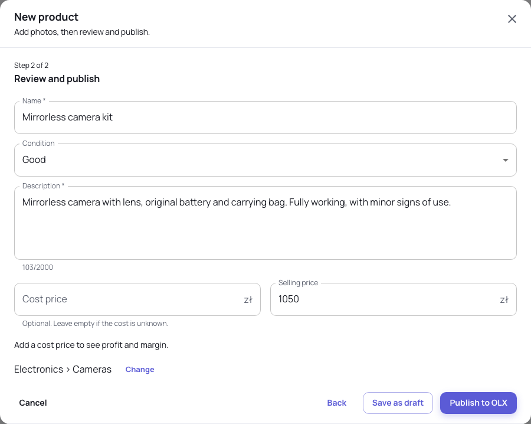
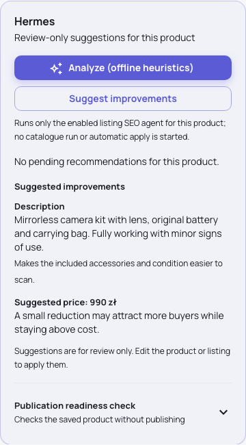
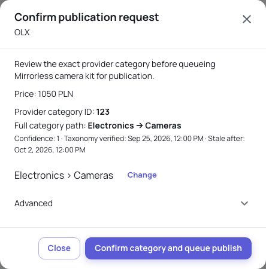

# Changelog

## [0.22.0](https://github.com/quokkify/marketdesk/compare/frontend-v0.21.1...frontend-v0.22.0) (2026-11-23)

<!-- project-toolkit:release-notes v2 -->
**At a glance:** ⚠️ 4 breaking · 16 new · 4 fixed · 1 internal

### ⚠️ Breaking changes

> [!WARNING]
> create and publish a product from two wizard screens ([#458](https://github.com/quokkify/marketdesk/pull/458))

> [!WARNING]
> cut the shell to the autopilot core ([#447](https://github.com/quokkify/marketdesk/pull/447))
>
> The Dashboard, Analytics and Listings pages, the notifications control, the bulk-action placeholders, the Notifications, API Keys, Telegram, Security and Hermes AI settings sections, the roadmap marketplace cards and the import panel are no longer part of the interface. The listing SEO agent and its creativity preset keep their stored values and can still be changed through `PATCH /api/settings/hermes`; no screen edits them.

> [!WARNING]
> remove endpoints that lost their callers ([#448](https://github.com/quokkify/marketdesk/pull/448))
>
> These endpoints no longer exist and answer 404 with the error code `NOT_FOUND`: `GET` and `PATCH /api/settings/notifications`, `GET /api/analytics/revenue`, `GET /api/analytics/listings`, `POST /api/hermes/run`, `POST /api/marketplaces/:id/import-preview`, `POST /api/marketplaces/:id/import`. `GET /api/settings/integrations` no longer returns the `telegram` and `api_keys` items.
>
> An API client that analysed the whole catalogue with `POST /api/hermes/run` calls `POST /api/hermes/products/:productId/run` once per product instead. The other removed endpoints have no replacement at this stage.

> [!WARNING]
> **security:** refuse a Hermes agent that has tools enabled — MarketDesk now refuses a Hermes Agent whose API server has any tool enabled (terminal, files, browser, memory), so seller text can no longer steer an agent that acts on your server. In `auto` mode AI falls back to offline heuristics, in `hermes` mode AI requests fail until Hermes runs without tools. ([#467](https://github.com/quokkify/marketdesk/pull/467))
>
> 1. Create a Hermes profile without tools as described in `docs/deployment/caddy-cloudflare-vps.md` ("Hermes profile without tools"), with its own `API_SERVER_KEY`.
> 2. Confirm with `GET /p/<profile>/v1/toolsets` that no toolset is enabled.
> 3. Set `HERMES_API_URL` to `http://<hermes-host>:8642/p/<profile>/v1` and `HERMES_API_KEY` to that profile's key, then restart MarketDesk.
> 4. On a production instance also set `REGISTRATION_ENABLED=false`.

### ✨ New

- reanimate marketdesk into a tester-ready mvp (sandbox olx, offline hermes, prd ui) — - MarketDesk runs end to end without OLX credentials: an OLX sandbox account, stub categories and simulated metrics, all labelled Sandbox. - Hermes AI degrades to labelled, review-only offline heuristics when the Hermes server is unreachable. - Boot refuses placeholder secrets and explains how to fix them; `npm run env:init` generates them. ([#434](https://github.com/quokkify/marketdesk/pull/434))

  > **Migration**
  >
  > - Migrations 042 (`hermes_events.source`) and 043 (`category_correction_operations.listing_id` nullable, `ON DELETE SET NULL`) run through the Compose `migrate` service or `npm run db:migrate`; both are idempotent.
  > - Run `npm run env:init` (or set `JWT_SECRET` ≥ 32 chars and a base64 32-byte `MARKETPLACE_CREDENTIALS_KEY`) before the first boot.
  > - For a real OLX deployment set `OLX_ADAPTER_MODE=real` and a publicly reachable `PUBLIC_BASE_URL`; the default `stub` mode labels everything Sandbox.
  >
  > 🤖 Generated with [Claude Code](https://claude.com/claude-code)
  >
  > https://claude.ai/code/session_01G7RDWHiEDE7j584o2tQQSL
- **ai:** show tokens per analysis, AI usage and Hermes limits — See what AI analyses use: each analysis on the product page shows its tokens, and the Hermes page shows AI usage for today and the last 7 days plus the AI provider's account limits (5-hour and weekly windows, reset times). Unknown values are shown as unknown, never as 0. ([#479](https://github.com/quokkify/marketdesk/pull/479))
- **conversations:** draft OLX buyer replies for the seller to send — The product page now lists OLX buyer conversations with a Hermes-drafted reply: edit it and press Send, nothing goes out without you. Scam, spam and injection messages are flagged, and a reply never offers less than the new "Lowest price you accept". ([#489](https://github.com/quokkify/marketdesk/pull/489))
- **olx:** import adverts already live on OLX — A connected OLX account can import the adverts already live on OLX again: "Import from OLX" on the Marketplaces page previews every advert with its status, then imports the new and changed ones as products. Nothing is written to OLX. ([#469](https://github.com/quokkify/marketdesk/pull/469))
- **olx:** reactivate expired OLX adverts instead of duplicating them — An expired OLX advert can be brought back from its product page with "Reactivate on OLX": the same advert, link and history return instead of a duplicate. If OLX's free limit for the category is used up, MarketDesk says so and buys nothing. ([#478](https://github.com/quokkify/marketdesk/pull/478))
- **olx:** revive an expired OLX advert with Hermes proposals — Bring an expired OLX advert back in better shape: "Revive on OLX" on the product page shows what is missing (condition, cost price), Hermes's proposed title, description and price with checkboxes, and one button that applies the ticked changes, updates the advert on OLX and reactivates it. Publishing to OLX now asks for the product's condition instead of sending "used" silently. ([#483](https://github.com/quokkify/marketdesk/pull/483))
- **pricing:** find comparable used prices on OLX and pick them — A new "Find comparables on OLX" button in Price research looks up current OLX adverts for the item and lists them with prices and links. Untick what does not match and add the rest; the next price analysis treats them as observed market prices. ([#491](https://github.com/quokkify/marketdesk/pull/491))
- **pricing:** propose a justified start and floor price for used items — The product analysis now proposes a start and floor price for a used item, built from the new-store price and comparable prices you enter on the product page. Each figure says whether it is observed or estimated, and the price shows how far it sits below new. ([#488](https://github.com/quokkify/marketdesk/pull/488))
- **pricing:** research prices in the background with class checks — Price research now runs in the background and finds real substitutes: Find prices returns at once, the page shows progress, and the estimate appears when the search finishes. Offers of another class are dropped by code, and a new Missing accessories field lowers the estimate. ([#502](https://github.com/quokkify/marketdesk/pull/502))
- **pricing:** send manual price changes to OLX — Changing a price yourself now updates OLX too. A new price set in the listing price dialog or in Edit product reaches the product, every listing and the live OLX advert, like an approved AI price, and the message says whether it was sent to OLX. ([#493](https://github.com/quokkify/marketdesk/pull/493))
- **pricing:** suggest a start price for items no longer sold new — Items no longer sold new now get a start price. The agent looks up the same model used, the last new price and today's new and used substitutes, saves them by tier, and keeps the start price at or below 70 % of the cheapest new substitutes. Use Find prices on the product page. ([#494](https://github.com/quokkify/marketdesk/pull/494))
- **product-page:** one Hermes card with prices, checks and run history — The product page now has one Hermes card under Statistics instead of four AI cards. It shows the verdict, the reason and one next action; click a row to open a side panel with market prices, checks, suggestions, and a log and history of every run. Add prices you found yourself under Your prices. ([#514](https://github.com/quokkify/marketdesk/pull/514))
- **products:** analyze and review AI suggestions from the catalogue row — The Products page drops the empty Markets, Cost, Profit and Tags columns. Each row has an Analyze with AI button, and the suggestions open under the row with Approve and Dismiss, so you stay on the Active tab. You can also analyze several selected products in one go. ([#495](https://github.com/quokkify/marketdesk/pull/495))
- **products:** show view growth and a needs-action tab in the catalogue — Each product row now shows its views with 7-day growth and a 14-day trend, and the Needs action tab lists active products where a buyer is waiting, the OLX listing expired or failed, or views stopped growing for a week. Pending AI suggestions stay counted after a reload. ([#497](https://github.com/quokkify/marketdesk/pull/497))
- **products:** show whether a product is ready to sell — Analyze now gives a sale verdict per product (Ready to sell / Not ready / Needs you) with reasons for info, price and photos, shown in the catalogue row and on the product page. Review price re-checks only the price against the market ceiling. The Suggest improvements button is gone. ([#504](https://github.com/quokkify/marketdesk/pull/504))
- **products:** show why a live listing gets no response — The catalogue now says whether a silent OLX listing is still too early to judge or is not being seen. For a listing that is not seen, "Why no response?" reports where the advert stands in OLX search for buyer phrases and what to change. Nothing is applied automatically. ([#515](https://github.com/quokkify/marketdesk/pull/515))

### 🐛 Fixed

- **olx:** give imported OLX adverts their category and status — Importing from OLX no longer marks every advert as unsupported: MarketDesk now reads the category OLX actually sends (`category_id`), and expired, removed and moderation-blocked OLX adverts get the matching MarketDesk status on import and sync. ([#475](https://github.com/quokkify/marketdesk/pull/475))
- **olx:** show an empty condition field in the revival dialog when the condition is unknown — The revival dialog now shows an empty condition field with "Choose condition" when the product's condition is unknown, instead of a value that looked already chosen. ([#486](https://github.com/quokkify/marketdesk/pull/486))
- **products:** keep typed prices when scrolling over the price field — Scrolling the page or the edit form while a price field is focused no longer changes the price. Before, each wheel or trackpad tick lowered or raised it by 0.01 (279 was saved as 278.84) and the changed price was sent to OLX. ([#506](https://github.com/quokkify/marketdesk/pull/506))
- **security:** sign out every device and expire idle sessions — Sign out now ends the session on every device, Settings has a Change password card that signs out your other devices, and operators can revoke a user's sessions with `npm run auth:revoke -- <email>`. Sessions expire after 24 h of inactivity and renew while in use. ([#468](https://github.com/quokkify/marketdesk/pull/468))

  > **Migration**
  >
  > 1. If your `.env` still has `JWT_EXPIRATION=7d` (copied from the old example), change it to `24h`; the app keeps 7d but logs a warning at boot.
  > 2. `JWT_EXPIRATION` and the new `JWT_RENEW_AFTER` (default `12h`) accept `<integer><unit>` with `s`, `m`, `h` or `d` only; rewrite values such as `2 days` as `2d`, or the app refuses to start and names the variable.

Internal changes (1 PR)

**Maintenance**

- **deps:** remove Playwright ([#500](https://github.com/quokkify/marketdesk/pull/500))

## [0.21.1](https://github.com/quokkify/marketdesk/compare/frontend-v0.21.0...frontend-v0.21.1) (2026-10-03)

<!-- project-toolkit:rich-block:start -->
<!-- project-toolkit:rich-release-notes pr=345 -->
### ✨ Highlights
- Migrated the combined changelog into backend, frontend, and assets histories, preserving historical entries, links, and explicit legacy provenance.
- Added conservation checks and corrected release-note enrichment so repeated runs do not accumulate blank lines.

### 🔄 Migration
No runtime migration. All GitHub Release metadata/tags/assets are unchanged. Legacy 1.0.0 is documented as an overlapping combined bootstrap snapshot, not a component bump. Native Release Please remains bump authority.
<!-- project-toolkit:rich-block:end -->

### 📚 Documentation

* **release:** migrate inherited component changelog histories ([#345](https://github.com/quokkify/marketdesk/issues/345)) ([ebcef80](https://github.com/quokkify/marketdesk/commit/ebcef80f805f3483ee63462a72c8ab27e0fd9bf1))

## [0.21.0](https://github.com/quokkify/marketdesk/compare/marketdesk-v0.20.0...frontend-v0.21.0) (2026-10-03)

### ✨ Features

* **release:** initialize frontend and assets streams ([#341](https://github.com/quokkify/marketdesk/issues/341)) ([fd00d03](https://github.com/quokkify/marketdesk/commit/fd00d0313bbc1e1532b9df363dae0304448bccaf))

## Inherited legacy history

These are combined MarketDesk releases, not independently published frontend versions. Original dates, compare links, commit and PR links remain authoritative. The 1.0.0 bootstrap snapshot repeats earlier work; it is not a component version bump.

See the [migration audit](../../docs/deployment/changelog-history-migration.md) for path evidence, overlap accounting and release-order limitations.

## Legacy [0.20.0](https://github.com/quokkify/marketdesk/compare/marketdesk-v0.19.2...marketdesk-v0.20.0) (2026-10-03)

<!-- project-toolkit:rich-block:start -->
<!-- project-toolkit:rich-release-notes pr=311 -->
### ✨ Highlights
**Create product → Prepare listing → Check readiness → Review → Publish**

**1. Review the product**

**2. See optional wording and price suggestions**

**3. Confirm publication**

*Screenshots use mocked demo data. Suggestions are optional, and publication remains your decision.*
<!-- project-toolkit:rich-block:end -->

### ✨ Features

<!-- legacy-entry:1 -->
* graph-backed product publication journey via LangGraph ([#311](https://github.com/quokkify/marketdesk/issues/311)) ([04bdd47](https://github.com/quokkify/marketdesk/commit/04bdd47fd2def495999401e9a1e8e9c8070488cd))

## Legacy 1.0.0 (2026-09-25)

Inherited bootstrap snapshot: overlaps prior combined releases; repeated entries below are retained as originally recorded, not new releases.

### Features

<!-- legacy-entry:5 -->
* **analytics:** restore historical reporting ([#247](https://github.com/quokkify/marketdesk/issues/247)) ([36915a5](https://github.com/quokkify/marketdesk/commit/36915a5e4a4a15098052f0786d6af8caa339de28))

<!-- legacy-entry:7 -->
* **branding:** add MarketDesk site icon assets ([#210](https://github.com/quokkify/marketdesk/issues/210)) ([1ba2edf](https://github.com/quokkify/marketdesk/commit/1ba2edfac4e9f26cacbd3d82c70856c268763918))

<!-- legacy-entry:8 -->
* close MarketDesk product and AI tasks ([#162](https://github.com/quokkify/marketdesk/issues/162)) ([125081b](https://github.com/quokkify/marketdesk/commit/125081b9eb74fe03fb2a0fcaa66634808d1ee0f6))

<!-- legacy-entry:9 -->
* **hermes:** add product-scoped listing SEO analysis ([#263](https://github.com/quokkify/marketdesk/issues/263)) ([846beb3](https://github.com/quokkify/marketdesk/commit/846beb3eff7a0b27e05e9307dd72ce8fe4c9e05a))

<!-- legacy-entry:10 -->
* **hermes:** compact SEO review UX ([#266](https://github.com/quokkify/marketdesk/issues/266)) ([e750531](https://github.com/quokkify/marketdesk/commit/e7505319a1869a4326cdb6f3e35578caa7fe5093))

<!-- legacy-entry:11 -->
* **hermes:** define canonical event lifecycle ([#186](https://github.com/quokkify/marketdesk/issues/186)) ([64d1a64](https://github.com/quokkify/marketdesk/commit/64d1a64e9b27f551222ab8adcff2d1832f1f3f83))

<!-- legacy-entry:12 -->
* **hermes:** polish AI activity dashboard ([#236](https://github.com/quokkify/marketdesk/issues/236)) ([0dae30c](https://github.com/quokkify/marketdesk/commit/0dae30cc44f41549e6cc61f3bb481a8f2ce23803))

<!-- legacy-entry:14 -->
* implement MarketDesk multi-marketplace SaaS platform ([#1](https://github.com/quokkify/marketdesk/issues/1)) ([2259d71](https://github.com/quokkify/marketdesk/commit/2259d71d96ac742ad5eb07a5b97bada6915de88b))

<!-- legacy-entry:15 -->
* **listings:** add publish preview dry run ([#77](https://github.com/quokkify/marketdesk/issues/77)) ([d096106](https://github.com/quokkify/marketdesk/commit/d0961064639e5667322144a124878e6db00b5e91))

<!-- legacy-entry:16 -->
* **listings:** add safe delist-to-draft workflow ([#238](https://github.com/quokkify/marketdesk/issues/238)) ([57569be](https://github.com/quokkify/marketdesk/commit/57569beb72ee33178a592d3c68d1082f1dc7356d))

<!-- legacy-entry:17 -->
* **listings:** confirm OLX quota override in publish review ([#202](https://github.com/quokkify/marketdesk/issues/202)) ([4627ed8](https://github.com/quokkify/marketdesk/commit/4627ed89a9b28f0f328e933dfac58cb3197c13b4))

<!-- legacy-entry:18 -->
* **listings:** create draft listings from products ([#76](https://github.com/quokkify/marketdesk/issues/76)) ([22cbcd6](https://github.com/quokkify/marketdesk/commit/22cbcd6378ce520116f5a3941ad187f3c9ba976e))

<!-- legacy-entry:19 -->
* **listings:** expose canonical marketplace links ([#111](https://github.com/quokkify/marketdesk/issues/111)) ([e7d086d](https://github.com/quokkify/marketdesk/commit/e7d086da187f9852e9294e17616c9769fe64533a))

<!-- legacy-entry:20 -->
* **olx:** add conversations metric ([#262](https://github.com/quokkify/marketdesk/issues/262)) ([d812b6d](https://github.com/quokkify/marketdesk/commit/d812b6de385f964fd178085e17708159b8bfdc0a))

<!-- legacy-entry:22 -->
* **olx:** add OAuth and guarded real publishing ([#93](https://github.com/quokkify/marketdesk/issues/93)) ([a13125f](https://github.com/quokkify/marketdesk/commit/a13125fc2ce00fdb93501d9d4bcb434629ce465e))

<!-- legacy-entry:24 -->
* **olx:** import existing adverts ([#133](https://github.com/quokkify/marketdesk/issues/133)) ([7403716](https://github.com/quokkify/marketdesk/commit/74037161f96b53d83b16e84830b04d61d5d4d37b))

<!-- legacy-entry:27 -->
* **olx:** preview owned advert imports ([#119](https://github.com/quokkify/marketdesk/issues/119)) ([6b4ac91](https://github.com/quokkify/marketdesk/commit/6b4ac91494610c46c171f75df72e1da0eb3327e8))

<!-- legacy-entry:29 -->
* **products:** add on-demand publication recheck ([#246](https://github.com/quokkify/marketdesk/issues/246)) ([446337b](https://github.com/quokkify/marketdesk/commit/446337bfb65abce9c452fe2c9834aa650937b748))

<!-- legacy-entry:30 -->
* **products:** add wizard image uploads ([#183](https://github.com/quokkify/marketdesk/issues/183)) ([6c844e9](https://github.com/quokkify/marketdesk/commit/6c844e968ff8b4ede01b3f5ab5d77a8d2caee0de))

<!-- legacy-entry:32 -->
* **products:** redesign catalogue ([#223](https://github.com/quokkify/marketdesk/issues/223)) ([596102a](https://github.com/quokkify/marketdesk/commit/596102a11750e64a777911eb4d967b5a2e55d115))

<!-- legacy-entry:33 -->
* **products:** redesign product detail page ([#219](https://github.com/quokkify/marketdesk/issues/219)) ([6030b7f](https://github.com/quokkify/marketdesk/commit/6030b7fd21cc511c9e8d37fa66df528c0795a379))

<!-- legacy-entry:34 -->
* **settings:** add persistent settings contracts ([#234](https://github.com/quokkify/marketdesk/issues/234)) ([dcc7f94](https://github.com/quokkify/marketdesk/commit/dcc7f94f150bf31295ebd80158be42d76c60afd8)), closes [#149](https://github.com/quokkify/marketdesk/issues/149)

<!-- legacy-entry:35 -->
* **settings:** show installed release version ([#211](https://github.com/quokkify/marketdesk/issues/211)) ([a10524f](https://github.com/quokkify/marketdesk/commit/a10524fea85c8cb5efa333291d1fa05e99eb80f4))

<!-- legacy-entry:36 -->
* store OLX app credentials per workspace ([#129](https://github.com/quokkify/marketdesk/issues/129)) ([18d1661](https://github.com/quokkify/marketdesk/commit/18d16610abdf7b3f2ff5a1b628e56b10d5522c2e))

<!-- legacy-entry:37 -->
* **sync:** reconcile product category provenance ([#214](https://github.com/quokkify/marketdesk/issues/214)) ([8de95e0](https://github.com/quokkify/marketdesk/commit/8de95e0c54634f7f717a03b51bfe46020a60831a))

<!-- legacy-entry:39 -->
* **wizard:** autosave product drafts ([#181](https://github.com/quokkify/marketdesk/issues/181)) ([243448d](https://github.com/quokkify/marketdesk/commit/243448d7910577ef8d34fe958c6d8b232e086c90))

### Bug Fixes

<!-- legacy-entry:40 -->
* **analytics:** label top listings by identity ([#122](https://github.com/quokkify/marketdesk/issues/122)) ([4859262](https://github.com/quokkify/marketdesk/commit/48592625b1757616f391cb24ba137d046bdae445))

<!-- legacy-entry:42 -->
* **analytics:** restore legacy view baseline ([#249](https://github.com/quokkify/marketdesk/issues/249)) ([e552a8d](https://github.com/quokkify/marketdesk/commit/e552a8d2bc39ff172442bec76aa0ee5280d6cfc9))

<!-- legacy-entry:43 -->
* **analytics:** separate date range labels ([#104](https://github.com/quokkify/marketdesk/issues/104)) ([1188010](https://github.com/quokkify/marketdesk/commit/1188010db14ddc2cfc261baa9598d25be2ce9371))

<!-- legacy-entry:44 -->
* **analytics:** show readable listing identity ([#105](https://github.com/quokkify/marketdesk/issues/105)) ([c93ad34](https://github.com/quokkify/marketdesk/commit/c93ad34afbbee2fda7a94ed05a5cb4b989687356))

<!-- legacy-entry:45 -->
* **dashboard:** realign operations command center ([#230](https://github.com/quokkify/marketdesk/issues/230)) ([f652496](https://github.com/quokkify/marketdesk/commit/f6524969b7d69fbf79f65006c2c6ee4efae835b3))

<!-- legacy-entry:46 -->
* **dashboard:** realign overview layout ([5ea5c70](https://github.com/quokkify/marketdesk/commit/5ea5c7097ac352dbedd09a4a097785d1078d2e40))

<!-- legacy-entry:50 -->
* **deps:** update @reduxjs/toolkit to v2 ([#28](https://github.com/quokkify/marketdesk/issues/28)) ([b3c0af9](https://github.com/quokkify/marketdesk/commit/b3c0af9db49b7790736caba07aa9e541e284e845))

<!-- legacy-entry:60 -->
* **deps:** update material-ui monorepo to v6 ([#36](https://github.com/quokkify/marketdesk/issues/36)) ([4f1f2ef](https://github.com/quokkify/marketdesk/commit/4f1f2ef1ef5c0d7ccd33ad6b0c31ae0ec7894e8c))

<!-- legacy-entry:61 -->
* **deps:** update material-ui monorepo to v9 ([cad76d1](https://github.com/quokkify/marketdesk/commit/cad76d11e243c33e306ca80a1a63fc53f5e178ae))

<!-- legacy-entry:67 -->
* **deps:** update react monorepo to v19 ([#63](https://github.com/quokkify/marketdesk/issues/63)) ([01ce255](https://github.com/quokkify/marketdesk/commit/01ce255d00a34bc89dcfa6785c8e80bca92062c2))

<!-- legacy-entry:68 -->
* **deps:** update react-redux to v9 ([#29](https://github.com/quokkify/marketdesk/issues/29)) ([4f53ebf](https://github.com/quokkify/marketdesk/commit/4f53ebfc624a7501ec0240bf8a9f93a96ed26d87))

<!-- legacy-entry:69 -->
* **deps:** update react-router-dom to v7 ([#44](https://github.com/quokkify/marketdesk/issues/44)) ([e2ecb2f](https://github.com/quokkify/marketdesk/commit/e2ecb2fa2a40aca2219af4bf0399869ec12bf7c8))

<!-- legacy-entry:70 -->
* **deps:** update recharts to v3 ([#24](https://github.com/quokkify/marketdesk/issues/24)) ([ed00ee5](https://github.com/quokkify/marketdesk/commit/ed00ee5e7c3c1b496d271ecbc8f28e5e49c75674))

<!-- legacy-entry:79 -->
* **frontend:** finish canonical shell refinement ([#233](https://github.com/quokkify/marketdesk/issues/233)) ([55f3800](https://github.com/quokkify/marketdesk/commit/55f38000e17889af798c2e6446c354f09a0a405e))

<!-- legacy-entry:80 -->
* **frontend:** recover stale lazy-loaded chunks ([#222](https://github.com/quokkify/marketdesk/issues/222)) ([f0961a9](https://github.com/quokkify/marketdesk/commit/f0961a9f3e678224d7400a8bcb2429a407b9d918))

<!-- legacy-entry:85 -->
* **listings:** remove detached metrics legend ([#123](https://github.com/quokkify/marketdesk/issues/123)) ([b0ca652](https://github.com/quokkify/marketdesk/commit/b0ca652746bbba4ea49e14913fc13fe958d48636))

<!-- legacy-entry:86 -->
* **listings:** show product identity in listings ([#124](https://github.com/quokkify/marketdesk/issues/124)) ([4decc6f](https://github.com/quokkify/marketdesk/commit/4decc6fa411a3a2ad5911746d4722a3368e9deba))

<!-- legacy-entry:88 -->
* **marketplaces:** clarify card status and sync settings ([#106](https://github.com/quokkify/marketdesk/issues/106)) ([14ad08c](https://github.com/quokkify/marketdesk/commit/14ad08cde92795eaa931199ec2d8d69a1ab2d4c2))

<!-- legacy-entry:94 -->
* **olx:** prevent wrong category publish and guide quota-safe recreation ([#190](https://github.com/quokkify/marketdesk/issues/190)) ([4b097fa](https://github.com/quokkify/marketdesk/commit/4b097fa5044fff05286d7e789b31e014e5185ba6))

<!-- legacy-entry:97 -->
* **olx:** stop treating phone views as messages ([#212](https://github.com/quokkify/marketdesk/issues/212)) ([42f8c86](https://github.com/quokkify/marketdesk/commit/42f8c86c055b5b7dbd7d21bc3eb73100d65b17f0))

<!-- legacy-entry:101 -->
* **pricing:** allow intentional below-cost sales ([#101](https://github.com/quokkify/marketdesk/issues/101)) ([c05700a](https://github.com/quokkify/marketdesk/commit/c05700a2a8d162f4dae52f20a65bb9ecbd7f12bb))

<!-- legacy-entry:102 -->
* **product:** center full-size image preview ([#166](https://github.com/quokkify/marketdesk/issues/166)) ([a9a7091](https://github.com/quokkify/marketdesk/commit/a9a7091fc8b8c7366733809e8651b87e9dd7082c))

<!-- legacy-entry:103 -->
* **product:** connect recommendations and marketplace status ([#163](https://github.com/quokkify/marketdesk/issues/163)) ([5f5f120](https://github.com/quokkify/marketdesk/commit/5f5f120ec407b7abc03ae85f877cef85675eb17b))

<!-- legacy-entry:104 -->
* **products:** repair details editing and layout ([#102](https://github.com/quokkify/marketdesk/issues/102)) ([596f1ec](https://github.com/quokkify/marketdesk/commit/596f1ec216c1e332e81bd8de3dfca6d4eb6da10a))

<!-- legacy-entry:105 -->
* **products:** require below-cost confirmation ([#184](https://github.com/quokkify/marketdesk/issues/184)) ([8ddff61](https://github.com/quokkify/marketdesk/commit/8ddff618283c56e4c57579a34ef7497ee2019c25))

<!-- legacy-entry:111 -->
* restore Docker startup and account registration ([#5](https://github.com/quokkify/marketdesk/issues/5)) ([4d047fe](https://github.com/quokkify/marketdesk/commit/4d047fe63434f4b2a6de710979a156f3e0b62b26))

<!-- legacy-entry:114 -->
* **settings:** add sectioned settings shell ([8609684](https://github.com/quokkify/marketdesk/commit/860968483d7f9c21ee61397891999bbec921b83a))

<!-- legacy-entry:115 -->
* **shell:** move profile control to sidebar ([348a586](https://github.com/quokkify/marketdesk/commit/348a586b4c84bd348fefdb00dfdbd36964864fd3))

<!-- legacy-entry:116 -->
* **ui:** align primary action placement ([#103](https://github.com/quokkify/marketdesk/issues/103)) ([e463375](https://github.com/quokkify/marketdesk/commit/e463375d9b97560360eda09c94c1ef591962ebce))

<!-- legacy-entry:117 -->
* **ui:** restore canonical application shell ([#176](https://github.com/quokkify/marketdesk/issues/176)) ([04540e6](https://github.com/quokkify/marketdesk/commit/04540e660958138b94192846e8171b4620da2bae))

<!-- legacy-entry:118 -->
* **wizard:** validate required creation steps ([#180](https://github.com/quokkify/marketdesk/issues/180)) ([8451fe7](https://github.com/quokkify/marketdesk/commit/8451fe778b8c79687d16de6aaf92dc101084d14a))

## Legacy [0.19.0](https://github.com/ylazakovich/marketdesk/compare/marketdesk-v0.18.0...marketdesk-v0.19.0) (2026-07-23)

### ✨ Features

<!-- legacy-entry:123 -->
* **hermes:** compact SEO review UX ([#266](https://github.com/ylazakovich/marketdesk/issues/266)) ([e750531](https://github.com/ylazakovich/marketdesk/commit/e7505319a1869a4326cdb6f3e35578caa7fe5093))

## Legacy [0.18.0](https://github.com/ylazakovich/marketdesk/compare/marketdesk-v0.17.3...marketdesk-v0.18.0) (2026-07-22)

### ✨ Features

<!-- legacy-entry:124 -->
* **hermes:** add product-scoped listing SEO analysis ([#263](https://github.com/ylazakovich/marketdesk/issues/263)) ([846beb3](https://github.com/ylazakovich/marketdesk/commit/846beb3eff7a0b27e05e9307dd72ce8fe4c9e05a))

<!-- legacy-entry:125 -->
* **olx:** add conversations metric ([#262](https://github.com/ylazakovich/marketdesk/issues/262)) ([d812b6d](https://github.com/ylazakovich/marketdesk/commit/d812b6de385f964fd178085e17708159b8bfdc0a))

## Legacy [0.17.1](https://github.com/ylazakovich/marketdesk/compare/marketdesk-v0.17.0...marketdesk-v0.17.1) (2026-07-22)

### 🐛 Bug Fixes

<!-- legacy-entry:128 -->
* **analytics:** restore legacy view baseline ([#249](https://github.com/ylazakovich/marketdesk/issues/249)) ([e552a8d](https://github.com/ylazakovich/marketdesk/commit/e552a8d2bc39ff172442bec76aa0ee5280d6cfc9))

## Legacy [0.17.0](https://github.com/ylazakovich/marketdesk/compare/marketdesk-v0.16.0...marketdesk-v0.17.0) (2026-07-22)

### ✨ Features

<!-- legacy-entry:130 -->
* **analytics:** restore historical reporting ([#247](https://github.com/ylazakovich/marketdesk/issues/247)) ([36915a5](https://github.com/ylazakovich/marketdesk/commit/36915a5e4a4a15098052f0786d6af8caa339de28))

<!-- legacy-entry:131 -->
* **listings:** add safe delist-to-draft workflow ([#238](https://github.com/ylazakovich/marketdesk/issues/238)) ([57569be](https://github.com/ylazakovich/marketdesk/commit/57569beb72ee33178a592d3c68d1082f1dc7356d))

<!-- legacy-entry:132 -->
* **products:** add on-demand publication recheck ([#246](https://github.com/ylazakovich/marketdesk/issues/246)) ([446337b](https://github.com/ylazakovich/marketdesk/commit/446337bfb65abce9c452fe2c9834aa650937b748))

## Legacy [0.16.0](https://github.com/ylazakovich/marketdesk/compare/marketdesk-v0.15.0...marketdesk-v0.16.0) (2026-07-18)

### ✨ Features

<!-- legacy-entry:138 -->
* **hermes:** polish AI activity dashboard ([#236](https://github.com/ylazakovich/marketdesk/issues/236)) ([0dae30c](https://github.com/ylazakovich/marketdesk/commit/0dae30cc44f41549e6cc61f3bb481a8f2ce23803))

## Legacy [0.15.0](https://github.com/ylazakovich/marketdesk/compare/marketdesk-v0.14.2...marketdesk-v0.15.0) (2026-07-18)

### ✨ Features

<!-- legacy-entry:139 -->
* **settings:** add persistent settings contracts ([#234](https://github.com/ylazakovich/marketdesk/issues/234)) ([dcc7f94](https://github.com/ylazakovich/marketdesk/commit/dcc7f94f150bf31295ebd80158be42d76c60afd8)), closes [#149](https://github.com/ylazakovich/marketdesk/issues/149)

## Legacy [0.14.2](https://github.com/ylazakovich/marketdesk/compare/marketdesk-v0.14.1...marketdesk-v0.14.2) (2026-07-18)

### 🐛 Bug Fixes

<!-- legacy-entry:140 -->
* **frontend:** finish canonical shell refinement ([#233](https://github.com/ylazakovich/marketdesk/issues/233)) ([55f3800](https://github.com/ylazakovich/marketdesk/commit/55f38000e17889af798c2e6446c354f09a0a405e))

## Legacy [0.14.1](https://github.com/ylazakovich/marketdesk/compare/marketdesk-v0.14.0...marketdesk-v0.14.1) (2026-07-18)

### 🐛 Bug Fixes

<!-- legacy-entry:142 -->
* **dashboard:** realign operations command center ([#230](https://github.com/ylazakovich/marketdesk/issues/230)) ([f652496](https://github.com/ylazakovich/marketdesk/commit/f6524969b7d69fbf79f65006c2c6ee4efae835b3))

## Legacy [0.14.0](https://github.com/ylazakovich/marketdesk/compare/marketdesk-v0.13.0...marketdesk-v0.14.0) (2026-07-18)

### ✨ Features

<!-- legacy-entry:143 -->
* **products:** redesign catalogue ([#223](https://github.com/ylazakovich/marketdesk/issues/223)) ([596102a](https://github.com/ylazakovich/marketdesk/commit/596102a11750e64a777911eb4d967b5a2e55d115))

## Legacy [0.13.0](https://github.com/ylazakovich/marketdesk/compare/hermes-marketdesk-v0.12.1...hermes-marketdesk-v0.13.0) (2026-07-17)

### ✨ Features

<!-- legacy-entry:146 -->
* **products:** redesign product detail page ([#219](https://github.com/ylazakovich/marketdesk/issues/219)) ([6030b7f](https://github.com/ylazakovich/marketdesk/commit/6030b7fd21cc511c9e8d37fa66df528c0795a379))

### 🐛 Bug Fixes

<!-- legacy-entry:147 -->
* **frontend:** recover stale lazy-loaded chunks ([#222](https://github.com/ylazakovich/marketdesk/issues/222)) ([f0961a9](https://github.com/ylazakovich/marketdesk/commit/f0961a9f3e678224d7400a8bcb2429a407b9d918))

## Legacy [0.12.0](https://github.com/ylazakovich/marketdesk/compare/hermes-marketdesk-v0.11.1...hermes-marketdesk-v0.12.0) (2026-07-17)

### ✨ Features

<!-- legacy-entry:149 -->
* **sync:** reconcile product category provenance ([#214](https://github.com/ylazakovich/marketdesk/issues/214)) ([8de95e0](https://github.com/ylazakovich/marketdesk/commit/8de95e0c54634f7f717a03b51bfe46020a60831a))

## Legacy [0.11.1](https://github.com/ylazakovich/marketdesk/compare/hermes-marketdesk-v0.11.0...hermes-marketdesk-v0.11.1) (2026-07-17)

### 🐛 Bug Fixes

<!-- legacy-entry:150 -->
* **olx:** stop treating phone views as messages ([#212](https://github.com/ylazakovich/marketdesk/issues/212)) ([42f8c86](https://github.com/ylazakovich/marketdesk/commit/42f8c86c055b5b7dbd7d21bc3eb73100d65b17f0))

## Legacy [0.11.0](https://github.com/ylazakovich/marketdesk/compare/hermes-marketdesk-v0.10.1...hermes-marketdesk-v0.11.0) (2026-07-17)

### ✨ Features

<!-- legacy-entry:151 -->
* **branding:** add MarketDesk site icon assets ([#210](https://github.com/ylazakovich/marketdesk/issues/210)) ([1ba2edf](https://github.com/ylazakovich/marketdesk/commit/1ba2edfac4e9f26cacbd3d82c70856c268763918))

<!-- legacy-entry:152 -->
* **listings:** confirm OLX quota override in publish review ([#202](https://github.com/ylazakovich/marketdesk/issues/202)) ([4627ed8](https://github.com/ylazakovich/marketdesk/commit/4627ed89a9b28f0f328e933dfac58cb3197c13b4))

<!-- legacy-entry:153 -->
* **settings:** show installed release version ([#211](https://github.com/ylazakovich/marketdesk/issues/211)) ([a10524f](https://github.com/ylazakovich/marketdesk/commit/a10524fea85c8cb5efa333291d1fa05e99eb80f4))

## Legacy [0.10.1](https://github.com/ylazakovich/marketdesk/compare/hermes-marketdesk-v0.10.0...hermes-marketdesk-v0.10.1) (2026-07-16)

### 🐛 Bug Fixes

<!-- legacy-entry:158 -->
* **olx:** prevent wrong category publish and guide quota-safe recreation ([#190](https://github.com/ylazakovich/marketdesk/issues/190)) ([4b097fa](https://github.com/ylazakovich/marketdesk/commit/4b097fa5044fff05286d7e789b31e014e5185ba6))

## Legacy [0.10.0](https://github.com/ylazakovich/hermes-marketdesk/compare/hermes-marketdesk-v0.9.0...hermes-marketdesk-v0.10.0) (2026-07-16)

### ✨ Features

<!-- legacy-entry:160 -->
* **hermes:** define canonical event lifecycle ([#186](https://github.com/ylazakovich/hermes-marketdesk/issues/186)) ([64d1a64](https://github.com/ylazakovich/hermes-marketdesk/commit/64d1a64e9b27f551222ab8adcff2d1832f1f3f83))

<!-- legacy-entry:162 -->
* **products:** add wizard image uploads ([#183](https://github.com/ylazakovich/hermes-marketdesk/issues/183)) ([6c844e9](https://github.com/ylazakovich/hermes-marketdesk/commit/6c844e968ff8b4ede01b3f5ab5d77a8d2caee0de))

<!-- legacy-entry:164 -->
* **wizard:** autosave product drafts ([#181](https://github.com/ylazakovich/hermes-marketdesk/issues/181)) ([243448d](https://github.com/ylazakovich/hermes-marketdesk/commit/243448d7910577ef8d34fe958c6d8b232e086c90))

### 🐛 Bug Fixes

<!-- legacy-entry:167 -->
* **product:** center full-size image preview ([#166](https://github.com/ylazakovich/hermes-marketdesk/issues/166)) ([a9a7091](https://github.com/ylazakovich/hermes-marketdesk/commit/a9a7091fc8b8c7366733809e8651b87e9dd7082c))

<!-- legacy-entry:168 -->
* **product:** connect recommendations and marketplace status ([#163](https://github.com/ylazakovich/hermes-marketdesk/issues/163)) ([5f5f120](https://github.com/ylazakovich/hermes-marketdesk/commit/5f5f120ec407b7abc03ae85f877cef85675eb17b))

<!-- legacy-entry:169 -->
* **products:** require below-cost confirmation ([#184](https://github.com/ylazakovich/hermes-marketdesk/issues/184)) ([8ddff61](https://github.com/ylazakovich/hermes-marketdesk/commit/8ddff618283c56e4c57579a34ef7497ee2019c25))

<!-- legacy-entry:170 -->
* **ui:** restore canonical application shell ([#176](https://github.com/ylazakovich/hermes-marketdesk/issues/176)) ([04540e6](https://github.com/ylazakovich/hermes-marketdesk/commit/04540e660958138b94192846e8171b4620da2bae))

<!-- legacy-entry:171 -->
* **wizard:** validate required creation steps ([#180](https://github.com/ylazakovich/hermes-marketdesk/issues/180)) ([8451fe7](https://github.com/ylazakovich/hermes-marketdesk/commit/8451fe778b8c79687d16de6aaf92dc101084d14a))

## Legacy [0.9.0](https://github.com/ylazakovich/hermes-marketdesk/compare/hermes-marketdesk-v0.8.0...hermes-marketdesk-v0.9.0) (2026-07-15)

### ✨ Features

<!-- legacy-entry:174 -->
* close MarketDesk product and AI tasks ([#162](https://github.com/ylazakovich/hermes-marketdesk/issues/162)) ([125081b](https://github.com/ylazakovich/hermes-marketdesk/commit/125081b9eb74fe03fb2a0fcaa66634808d1ee0f6))

### 🐛 Bug Fixes

<!-- legacy-entry:175 -->
* **dashboard:** realign overview layout ([5ea5c70](https://github.com/ylazakovich/hermes-marketdesk/commit/5ea5c7097ac352dbedd09a4a097785d1078d2e40))

<!-- legacy-entry:177 -->
* **settings:** add sectioned settings shell ([8609684](https://github.com/ylazakovich/hermes-marketdesk/commit/860968483d7f9c21ee61397891999bbec921b83a))

<!-- legacy-entry:178 -->
* **shell:** move profile control to sidebar ([348a586](https://github.com/ylazakovich/hermes-marketdesk/commit/348a586b4c84bd348fefdb00dfdbd36964864fd3))

## Legacy [0.8.0](https://github.com/ylazakovich/hermes-marketdesk/compare/hermes-marketdesk-v0.7.0...hermes-marketdesk-v0.8.0) (2026-07-15)

### ✨ Features

<!-- legacy-entry:179 -->
* **olx:** import existing adverts ([#133](https://github.com/ylazakovich/hermes-marketdesk/issues/133)) ([7403716](https://github.com/ylazakovich/hermes-marketdesk/commit/74037161f96b53d83b16e84830b04d61d5d4d37b))

<!-- legacy-entry:180 -->
* store OLX app credentials per workspace ([#129](https://github.com/ylazakovich/hermes-marketdesk/issues/129)) ([18d1661](https://github.com/ylazakovich/hermes-marketdesk/commit/18d16610abdf7b3f2ff5a1b628e56b10d5522c2e))

## Legacy [0.7.0](https://github.com/ylazakovich/hermes-marketdesk/compare/hermes-marketdesk-v0.6.0...hermes-marketdesk-v0.7.0) (2026-07-15)

### ✨ Features

<!-- legacy-entry:186 -->
* **olx:** preview owned advert imports ([#119](https://github.com/ylazakovich/hermes-marketdesk/issues/119)) ([6b4ac91](https://github.com/ylazakovich/hermes-marketdesk/commit/6b4ac91494610c46c171f75df72e1da0eb3327e8))

### 🐛 Bug Fixes

<!-- legacy-entry:187 -->
* **analytics:** label top listings by identity ([#122](https://github.com/ylazakovich/hermes-marketdesk/issues/122)) ([4859262](https://github.com/ylazakovich/hermes-marketdesk/commit/48592625b1757616f391cb24ba137d046bdae445))

<!-- legacy-entry:189 -->
* **listings:** remove detached metrics legend ([#123](https://github.com/ylazakovich/hermes-marketdesk/issues/123)) ([b0ca652](https://github.com/ylazakovich/hermes-marketdesk/commit/b0ca652746bbba4ea49e14913fc13fe958d48636))

<!-- legacy-entry:190 -->
* **listings:** show product identity in listings ([#124](https://github.com/ylazakovich/hermes-marketdesk/issues/124)) ([4decc6f](https://github.com/ylazakovich/hermes-marketdesk/commit/4decc6fa411a3a2ad5911746d4722a3368e9deba))

## Legacy [0.6.0](https://github.com/ylazakovich/hermes-marketdesk/compare/hermes-marketdesk-v0.5.0...hermes-marketdesk-v0.6.0) (2026-07-15)

### ✨ Features

<!-- legacy-entry:192 -->
* **listings:** expose canonical marketplace links ([#111](https://github.com/ylazakovich/hermes-marketdesk/issues/111)) ([e7d086d](https://github.com/ylazakovich/hermes-marketdesk/commit/e7d086da187f9852e9294e17616c9769fe64533a))

<!-- legacy-entry:194 -->
* **olx:** add OAuth and guarded real publishing ([#93](https://github.com/ylazakovich/hermes-marketdesk/issues/93)) ([a13125f](https://github.com/ylazakovich/hermes-marketdesk/commit/a13125fc2ce00fdb93501d9d4bcb434629ce465e))

### 🐛 Bug Fixes

<!-- legacy-entry:198 -->
* **analytics:** separate date range labels ([#104](https://github.com/ylazakovich/hermes-marketdesk/issues/104)) ([1188010](https://github.com/ylazakovich/hermes-marketdesk/commit/1188010db14ddc2cfc261baa9598d25be2ce9371))

<!-- legacy-entry:199 -->
* **analytics:** show readable listing identity ([#105](https://github.com/ylazakovich/hermes-marketdesk/issues/105)) ([c93ad34](https://github.com/ylazakovich/hermes-marketdesk/commit/c93ad34afbbee2fda7a94ed05a5cb4b989687356))

<!-- legacy-entry:201 -->
* **marketplaces:** clarify card status and sync settings ([#106](https://github.com/ylazakovich/hermes-marketdesk/issues/106)) ([14ad08c](https://github.com/ylazakovich/hermes-marketdesk/commit/14ad08cde92795eaa931199ec2d8d69a1ab2d4c2))

<!-- legacy-entry:203 -->
* **pricing:** allow intentional below-cost sales ([#101](https://github.com/ylazakovich/hermes-marketdesk/issues/101)) ([c05700a](https://github.com/ylazakovich/hermes-marketdesk/commit/c05700a2a8d162f4dae52f20a65bb9ecbd7f12bb))

<!-- legacy-entry:204 -->
* **products:** repair details editing and layout ([#102](https://github.com/ylazakovich/hermes-marketdesk/issues/102)) ([596f1ec](https://github.com/ylazakovich/hermes-marketdesk/commit/596f1ec216c1e332e81bd8de3dfca6d4eb6da10a))

<!-- legacy-entry:206 -->
* **ui:** align primary action placement ([#103](https://github.com/ylazakovich/hermes-marketdesk/issues/103)) ([e463375](https://github.com/ylazakovich/hermes-marketdesk/commit/e463375d9b97560360eda09c94c1ef591962ebce))

## Legacy [0.4.0](https://github.com/ylazakovich/hermes-marketdesk/compare/hermes-marketdesk-v0.3.1...hermes-marketdesk-v0.4.0) (2026-07-13)

### Features

<!-- legacy-entry:212 -->
* **listings:** add publish preview dry run ([#77](https://github.com/ylazakovich/hermes-marketdesk/issues/77)) ([d096106](https://github.com/ylazakovich/hermes-marketdesk/commit/d0961064639e5667322144a124878e6db00b5e91))

<!-- legacy-entry:213 -->
* **listings:** create draft listings from products ([#76](https://github.com/ylazakovich/hermes-marketdesk/issues/76)) ([22cbcd6](https://github.com/ylazakovich/hermes-marketdesk/commit/22cbcd6378ce520116f5a3941ad187f3c9ba976e))

## Legacy [0.3.1](https://github.com/ylazakovich/hermes-marketdesk/compare/hermes-marketdesk-v0.3.0...hermes-marketdesk-v0.3.1) (2026-07-13)

### Bug Fixes

<!-- legacy-entry:214 -->
* **deps:** update material-ui monorepo to v9 ([cad76d1](https://github.com/ylazakovich/hermes-marketdesk/commit/cad76d11e243c33e306ca80a1a63fc53f5e178ae))

### Chores

<!-- legacy-entry:227 -->
* **deps:** update typescript to v7 ([e14ee7a](https://github.com/ylazakovich/hermes-marketdesk/commit/e14ee7a96223df148b9c25167e993560c2c1335f))

## Legacy [0.3.0](https://github.com/ylazakovich/hermes-marketdesk/compare/hermes-marketdesk-v0.2.1...hermes-marketdesk-v0.3.0) (2026-07-12)

### Bug Fixes

<!-- legacy-entry:230 -->
* **deps:** update @reduxjs/toolkit to v2 ([#28](https://github.com/ylazakovich/hermes-marketdesk/issues/28)) ([b3c0af9](https://github.com/ylazakovich/hermes-marketdesk/commit/b3c0af9db49b7790736caba07aa9e541e284e845))

<!-- legacy-entry:240 -->
* **deps:** update material-ui monorepo to v6 ([#36](https://github.com/ylazakovich/hermes-marketdesk/issues/36)) ([4f1f2ef](https://github.com/ylazakovich/hermes-marketdesk/commit/4f1f2ef1ef5c0d7ccd33ad6b0c31ae0ec7894e8c))

<!-- legacy-entry:246 -->
* **deps:** update react monorepo to v19 ([#63](https://github.com/ylazakovich/hermes-marketdesk/issues/63)) ([01ce255](https://github.com/ylazakovich/hermes-marketdesk/commit/01ce255d00a34bc89dcfa6785c8e80bca92062c2))

<!-- legacy-entry:247 -->
* **deps:** update react-redux to v9 ([#29](https://github.com/ylazakovich/hermes-marketdesk/issues/29)) ([4f53ebf](https://github.com/ylazakovich/hermes-marketdesk/commit/4f53ebfc624a7501ec0240bf8a9f93a96ed26d87))

<!-- legacy-entry:248 -->
* **deps:** update react-router-dom to v7 ([#44](https://github.com/ylazakovich/hermes-marketdesk/issues/44)) ([e2ecb2f](https://github.com/ylazakovich/hermes-marketdesk/commit/e2ecb2fa2a40aca2219af4bf0399869ec12bf7c8))

<!-- legacy-entry:249 -->
* **deps:** update recharts to v3 ([#24](https://github.com/ylazakovich/hermes-marketdesk/issues/24)) ([ed00ee5](https://github.com/ylazakovich/hermes-marketdesk/commit/ed00ee5e7c3c1b496d271ecbc8f28e5e49c75674))

## Legacy [0.2.1](https://github.com/ylazakovich/hermes-marketdesk/compare/hermes-marketdesk-v0.2.0...hermes-marketdesk-v0.2.1) (2026-07-12)

### Bug Fixes

<!-- legacy-entry:278 -->
* restore Docker startup and account registration ([#5](https://github.com/ylazakovich/hermes-marketdesk/issues/5)) ([4d047fe](https://github.com/ylazakovich/hermes-marketdesk/commit/4d047fe63434f4b2a6de710979a156f3e0b62b26))

## Legacy [0.2.0](https://github.com/ylazakovich/hermes-marketdesk/compare/hermes-marketdesk-v0.1.0...hermes-marketdesk-v0.2.0) (2026-07-12)

### Features

<!-- legacy-entry:281 -->
* implement MarketDesk multi-marketplace SaaS platform ([#1](https://github.com/ylazakovich/hermes-marketdesk/issues/1)) ([2259d71](https://github.com/ylazakovich/hermes-marketdesk/commit/2259d71d96ac742ad5eb07a5b97bada6915de88b))
